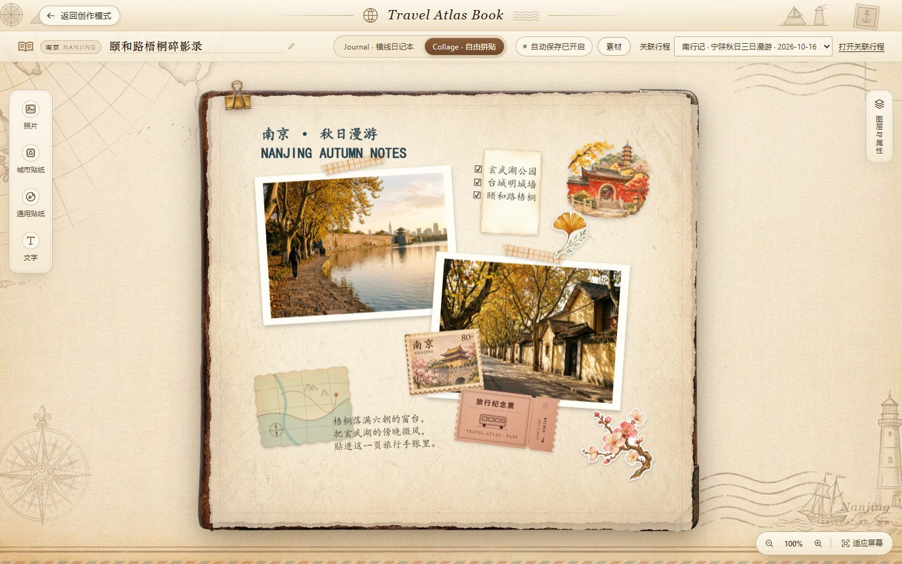
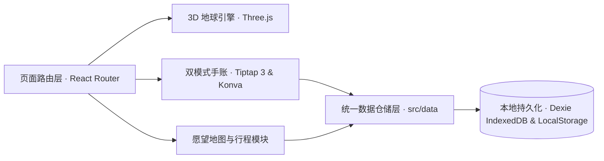

<p align="center">
  
</p>

<p align="center">
  <strong>一本会转的复古旅行手账</strong><br />
  <sub>融合 3D 地球探索、城市邮票收藏、双模式旅行手账与愿望行程规划的交互式 Web 应用</sub>
</p>

<p align="center">
  
  
  
  
  
</p>

<p align="center">
  <a href="#项目介绍">项目介绍</a> ·
  <a href="#探索世界">探索世界</a> ·
  <a href="#收藏城市">收藏城市</a> ·
  <a href="#记录旅途">记录旅途</a> ·
  <a href="#规划下一站">规划下一站</a> ·
  <a href="#本地数据持久化">本地数据持久化</a> ·
  <a href="#使用指南">使用指南</a> ·
  <a href="#技术架构">技术架构</a> ·
  <a href="#快速开始">快速开始</a>
</p>

<p align="center">
  
</p>

## 项目介绍

**Travel Atlas Book** 以 *Voyage Vintage* 复古航海手账为视觉语言，围绕「**把世界装进一本旅行手账**」的产品理念，在浏览器本地构建起一条从空间探索到记忆留存的完整旅行工作流：

> 转动 3D 地球 → 翻开城市明信片 → 收集城市邮票并新建手账 → 在横线日记或自由拼贴中记录旅途 → 用中国愿望地图规划下一站，并与手账双向关联。

### 设计初衷与核心特色

传统的在线游记往往偏重信息流发布与标准化模板，缺少翻开纸质笔记本时的温度与个人整理感；而离线纸本手账又难以将地理坐标探索、照片素材归档与多日行程编排串联在同一空间内。**Travel Atlas Book** 希望为热爱记录旅途的用户提供一座开箱即用的个人案头工作台——无需注册登录，也不依赖外部地图瓦片或云端服务，打开浏览器即可翻阅地球、盖章集邮、伏案写字与剪贴排版。

- **整画舞台与像素级热区对位**：首页桌案、牛皮纸邮票收藏册、创作方式选择页与横线日记本均以整幅手绘插画为基底，通过源图像素坐标换算百分比与容器查询单位（`cqw`），将真实可交互组件精确叠合在画面之上，完整保留帆船、油灯、装订折痕与光影层次。
- **全站统一的复古视觉规范**：从页面 CSS Modules 到 Three.js 程序化地球材质，统一读取同一套 `Voyage Vintage` 色板（午夜蓝、深海青、旧纸黄、奶油白、陶土红、鼠尾草绿、黄铜色）与系统内置字体栈，运行时不发起第三方字体或贴图请求。
- **双模式同本创作与素材闭环**：同一本旅行手账可随时切换 **Journal 横线日记本** 与 **Collage 自由拼贴**，两套内容独立持久化、互不覆盖，同时共享手账标题、同城私人照片库与内置贴纸资源。
- **Local-First 本地持久化与防丢稿设计**：地球贴图、中国地图底图与 39 枚内置贴纸随静态产物本地打包；全部手账、照片、邮票、愿望与行程均闭环保存在当前浏览器的 IndexedDB 与 `localStorage` 中，并配备防抖保存队列、多标签页写锁与离开保护机制。

> **当前版本状态（V1）**：核心功能、类型检查、单元测试与浏览器端到端回归均已完成，**尚未公开发布线上体验地址**，当前支持本地开发预览或打包后离线静态运行。首页顶部导航中的「灵感发现」与「我的」在当前版本中仅作为功能预告说明页展示（标记为「即将开放」），暂未上线社区内容、账号登录、云端同步、多人协作或导出文件功能。

<p align="center">
  
</p>

## 探索世界

### 交互式地球探索

**功能定位**：作为全站主入口（`/`），桌面端通过 5 层 `z-index` 分层与 CSS `mask-image` 挖孔遮罩，将 Three.js 渲染的真实 3D 地球直接嵌入 `1671×941` 复古手绘桌案画作之中，令前端帆船桅杆、云层与暖光轮廓保持原有的前景遮挡关系。球面贴图不依赖联网卫星瓦片，而是由浏览器 Canvas 2D 基于 Natural Earth 1:110m 陆地轮廓与固定随机种子（`20260721`）现场绘制等距圆柱投影油画纹理（含洋流短笔触、极地冰盖、经纬网格与海洋手写标注）。

**支持的操作与如何使用**：

- **自由旋转与缩放**：在地球圆孔内拖拽可旋转球面，滚轮或双指手势可进行阻尼缩放（限制俯仰角避免极点倒置）。指针按压或悬停在图钉附近时自动暂停地球自转并清除惯性余量，交互结束约 1.2 秒后恢复；页面切至后台时自动停帧以节省性能。
- **邻近图钉消歧与飞行转场**：点击地球上的城市图钉、右侧画作上的明信片热区，或点击左侧「开始探索」皮铭牌按序轮询城市，相机将通过四元数插值（`1.15s`）平滑飞向目标城市（在系统开启 `prefers-reduced-motion` 时直接落位）。针对南京、上海、杭州等近距离城市，系统依据指针按下原点与命中半径（鼠标 `18px` / 触屏 `28px`）优先选中最近且面向相机的城市，拖动超过 `8px` 时自动拦截误触。
- **顶部缎带导航与降级退路**：顶部缎带直接映射到「首页」「旅行手账」「灵感发现」「旅行计划」「我的」五个真实路由；当视口小于 `760×430` 或浏览器不支持 `cqw` 遮罩时，自动切换为竖版首页与城市快捷按钮列表；当浏览器无法启用 WebGL 时，地球容器自动退化为可直接点击的城市列表，保证核心探索链路不中断。

<p align="center">
  
  <br />
  <sub>首页桌面端实景舞台：可交互 3D 地球、顶部缎带导航与明信片快捷入口</sub>
</p>

**城市明信片与模块联动**：镜头抵达目标城市后，画面弹出对应的复古明信片弹层（`CityPostcard`），展示手绘城市地标剪影（`CityMotif`）、精确经纬度邮戳、城市标语与旅行短记。点击「先留在地球」或按 `Esc` 可返回地球继续探索；点击主按钮「**进入旅行手账**」则会携带城市编号跳转至 **城市邮票收藏册** 并自动展开该城市的手账书架。此外，内页顶栏提供城市档案门户（`/#/city/:cityId`）直达入口，用于查看城市背景并与同城手账书架、旅行计划互通（其中 **南京、上海、西安、北京、杭州、成都** 六城开放完整的邮票、贴纸、愿望地图与行程闭环；**伦敦**作为地球基线城市保留在地球、明信片、城市详情及手账书架入口中，暂不纳入六城邮票册、城市文化贴纸与愿望地图范围）。

<p align="center">
  
  <br />
  <sub>南京城市明信片弹层：展示手绘剪影、坐标邮戳与城市手账入口</sub>
</p>

<p align="center">
  
</p>

## 收藏城市

### 城市邮票收藏册

**功能定位**：城市邮票收藏册（`/#/section/journals`，别名 `/#/stamps`）是连接首页探索与具体手账创作的集散页。页面以 `1536×1024` 牛皮纸手账内页为舞台，围绕**南京、上海、西安、北京、杭州、成都**六座城市构建统一的邮票画廊，并在每枚邮票齿孔内侧精准覆有点击热区，避免相邻邮票误触。

<table width="100%">
  <tr>
    <td align="center" width="33%">
      <br />
      <strong>南京</strong> · <sub>明城墙</sub>
    </td>
    <td align="center" width="33%">
      <br />
      <strong>上海</strong> · <sub>旧外滩</sub>
    </td>
    <td align="center" width="33%">
      <br />
      <strong>西安</strong> · <sub>大雁塔</sub>
    </td>
  </tr>
  <tr>
    <td align="center" width="33%">
      <br />
      <strong>北京</strong> · <sub>天坛中轴</sub>
    </td>
    <td align="center" width="33%">
      <br />
      <strong>杭州</strong> · <sub>西湖断桥</sub>
    </td>
    <td align="center" width="33%">
      <br />
      <strong>成都</strong> · <sub>宽窄巷子</sub>
    </td>
  </tr>
</table>

**支持的操作与如何使用**：

- **展开城市手账书架**：点击任意城市邮票（再次点击或点击「收起」可折叠），下方即展开该城市的专属手账书架（`CityShelf`），按最近更新时间降序列出该城下所有手账，并标注「还没动笔」或「接着写」状态及上次更新日期。同一城市下支持创建与管理多本手账，彼此与跨城数据完全隔离。
- **显式盖章收集**：翻看邮票不会静默写入收藏状态；只有在书架头部主动点击「**盖下这枚收藏章**」，本地数据库才会记录收藏时间，并在对应邮票票面上盖印展示首次收集日期（`YYYY-MM-DD`）。重复点击不会覆盖首次收藏时间。
- **新建手账与模块联动**：点击「**新建一本**」将以默认命名（如 `南京手账 · 第 1 本`）创建新书并跳转至该手账的创作方式选择页；点击已有手账则继续打开编辑。书架上方同时提供「城市详情」与「城市旅行计划」链接，方便在邮票册、城市门户（`/city/:cityId`）和同城行程页（`/plan/city/:cityId`）之间直接切换。

<p align="center">
  
  <br />
  <sub>牛皮纸邮票收藏册：点亮已藏印章日期，下方展开城市手账书架与计划入口</sub>
</p>

<p align="center">
  
</p>

## 记录旅途

每本旅行手账都拥有独立路由 `/#/book/:bookId`，允许用户在 **创作方式选择页** 与 **统一手账壳**（`BookShell`）的支持下，在同一本手账中自由进入 **Journal 横线日记本** 与 **Collage 宽幅自由拼贴**。两种模式的内容独立保存、互不覆盖，并共享手账标题、城市私人照片库、城市文化贴纸与旅行计划关联。

<table width="100%">
  <tr>
    <th align="center" width="50%">Journal · 横线日记本</th>
    <th align="center" width="50%">Collage · 自由拼贴</th>
  </tr>
  <tr>
    <td valign="top" width="50%">
      
      <p>基于 Tiptap 3 定制，字号与行高贴合手绘纸面印刷横线，支持行内照片图注、独立自由贴纸图层、基础排版与结构校验保护。</p>
    </td>
    <td valign="top" width="50%">
      
      <p>基于 React Konva 构建 <code>1800×1600</code> 宽幅画布，支持照片、贴纸与楷体文字自由拖拽旋转、50%–200% 视口缩放与图层属性精调。</p>
    </td>
  </tr>
</table>

<p align="center">
  
  <br />
  <sub>创作方式选择页：同一本手账可随时切换横线日记或自由拼贴模式</sub>
</p>

### 城市旅行手账

**功能定位**：由入口容器 `BookPage`、模式选择页 `ModeSelect` 与公共编辑外壳 `BookShell` 共同构成，负责为两套编辑器提供统一的状态管理、本地存储读写与跨模块关联能力。

**支持的操作与模块联动**：

- **双模式分发与实时切换**：打开 `/#/book/:bookId` 时默认进入创作方式选择页（右上角动态显示当前城市徽标，仅进入选择页不会向数据库写入空白记录）；点选卡片后分别进入 `?mode=journal` 或 `?mode=collage`，并可在编辑页顶部的模式标签间一键往返切换。
- **标题修改与保存队列反馈**：顶部支持即时编辑手账标题（自动去除首尾空白，长度限制 `1–80` 字符）。标题、Journal 正文与 Collage 画布共享按书隔离的防抖保存队列，工具栏实时反馈「自动保存已开启 / 正在保存… / 已保存 / 保存失败（支持手动重试）」。
- **离开保护与多标签页冲突副本**：存在未写盘草稿时尝试切换路由或关闭页面，离开守卫（`LeaveGuard`）会自动拦截并先尝试补存；若保存失败，允许用户选择「重试保存并离开」「放弃修改并离开」或「留在本页」。若同一本手账在另一标签页被修改，当前页检测到前置版本冲突后会保留草稿并提示「另存本页正文 / 另存本页拼贴」，一键另存为新副本继续编辑。
- **绑定旅行计划**：对于六城范围内的手账，工具栏右侧内嵌「关联行程」选择器（`BookPlanLink`），可直接绑定包含当前城市的任意计划（每本手账至多关联一个计划）、随时更换或解除，并点击「打开关联行程」跳往对应行程详情页。

### Journal 横线日记本

**功能定位**：基于 **Tiptap 3** 开发的复古横线信纸编辑器，铺在 `1448×1086` 手绘横线页插画之上，沿用与邮票册一致的视觉比例及 `-1.8°` 微倾装订角度，纸面右上角自动同步显示手账标题与创建日期。

**支持的操作与如何使用**：

- **横线对齐与滚动书写**：正文字号（源图换算 `26px`）与行高（`47.6px`）严格贴合纸面 14 条可写印刷横线（下方为左下角邮票与右下角罗盘留白），超出 14 行后在书写区域内平滑纵向滚动，不改变纸页版式。
- **轻量格式工具条**：位于底部安全纸边上，提供不会破坏行高的**加粗（B）、斜体（I）、下划线（U）**以及**撤销 / 重做**按钮，同时提供**照片**与**贴纸**快捷入口。
- **行内媒体块（`atlasMedia`）**：点击工具栏「照片」或底部公共「素材」按钮，可在光标位置插入本地照片或贴纸；照片媒体块支持填写最多 `60` 字图注并展示只读资产编号，点击「取走这一格」即可移除。正文中仅记录 `photo:<uuid>` 或 `sticker:<id>` 引用，不嵌入图片二进制数据。
- **自由贴纸层与兼容性保护**：通过「贴纸」打开贴纸盒可将装饰贴纸自由叠放在纸页舞台上方（与正文输入互不抢占焦点）；加载手账时若检测到非标准或损坏的 Tiptap JSON 结构，编辑器会进入保护状态暂停自动保存，提示用户「重新读取正文」，防止原始存档被覆盖。

### Collage 自由拼贴

**功能定位**：基于 **React Konva + Konva** 构建的宽幅自由拼贴工作台，放置于木纹桌案、左翻封面、铜质长尾夹与多层纸张阴影之中。底层逻辑画布固定为 `1800×1600`（9:8），并内置居中偏移迁移逻辑（`normalizeCollageItems`），可无变形兼容恢复早期 `1200×1600` 版本的拼贴作品。

**支持的操作与如何使用**：

- **左侧素材导轨（`CollageToolPanel`）**：提供**照片**、**城市贴纸**、**通用贴纸**与**文字**四个工具面板。点击照片或贴纸可直接贴入画布（照片自动带有复古窄白边与纸面阴影），底部支持一键「打开素材册」上传本地照片；点击「添加文字」默认以楷体插入文本块。
- **自由变换与画布边界保护（`CollageStage`）**：基于 Konva `Transformer` 提供四角等比缩放与顶部旋转把手，拖动与变换结束后自动约束元素中心不超出可达画布边界；点击纸面空白处取消选中。
- **画布视口缩放**：右下角缩放控制条支持 `50%`–`200%` 共 10 档缩放调节（桌面端同时支持 `Ctrl / Cmd + 滚轮`），点击「适应屏幕」一键重置为适配当前窗口大小。视口缩放仅改变浏览比例，不改写持久化逻辑坐标。
- **悬浮工具栏与图层检查器（`CollageInspector`）**：选中画布元素后，上方浮出置顶、上移、下移、置底、编辑文字、适应画布（当元素部分超出纸面时一键缩回安全区内）与删除操作；右侧展开「图层与属性」面板可按数值精确调整旋转角度（`-180°`–`180°`）、缩放比例（`20%`–`300%`）、文字内容/字号/颜色/对齐/粗斜体，并在底部「图层列表」直观浏览和点选各图层。

### 城市特色素材与贴纸

**功能定位**：由内置静态复古贴纸库与按城市隔离的私人照片相册组成，在 Journal 与 Collage 两种创作模式及同城多本手账间打通共享。

**资源组成与支持的操作**：

- **39 枚本地内置贴纸**：
  - **34 枚核心共用贴纸**（`src/assets/stickers/`）：包括 **4 枚全域小集**（留声机、向日葵邮票、胶片相机、绿皮火车）、**6 枚城市邮票贴纸**（南京、上海、西安、北京、杭州、成都），以及 **24 枚城市文化贴纸**（六城各 4 枚，涵盖鸡鸣寺、鸭血粉丝汤、梅花、南京云锦、武康大楼、生煎包、白玉兰、海派旗袍少女、兵马俑、大雁塔、羊肉泡馍、石榴花、地坛、京剧、北京烤鸭、菊花、雷峰塔、东坡肉、桂花、西湖绸伞、武侯祠、担担面、川剧、蜀绣）。
  - **5 枚 Collage 专属拼贴装饰贴纸**（`src/assets/collage-stickers/`）：格子纸胶带、手账撕纸便签、复古旅行票根、手绘地图碎片、银杏叶贴纸，用于丰富宽幅拼贴的纸感层次。
- **本地照片上传与同城共享（`AssetPanel`）**：支持导入 `JPEG / PNG / WebP` 图片（单张源文件 `≤ 10 MB`，按真实文件字节头识别而非仅看扩展名），上传后在数据库写事务外完成解码，最长边超过 `1600 px` 时自动等比缩放（不放大原图，保留 PNG/WebP 透明通道）并按 `cityId` 写入照片库。一次上传即可在同城所有手账的 Journal 与 Collage 模式中重复选用。
- **贴纸盒检索与自由贴纸交互（`StickerPicker` / `StickerLayer`）**：在 Journal 中呼出贴纸盒默认展示「全域小集」与「城市邮票」，搜索框支持**中英文城市名或贴纸名查找**（如输入 `南京`、`Nanjing`、`Xi'an`、`xian` 均可定位对应城市文化贴纸），允许跨城市混贴且连续点击不关闭面板。贴到纸面上的贴纸选中后浮出 4 个白底黄铜边圆形把手（左上复制、右上删除、顶部旋转并支持按住 `Shift` 吸附至 `15°` 刻度、右下缩放），亦可通过键盘操作（`+`/`-` 缩放 `8%`、`[`/`]` 旋转 `5°` 或配合 `Shift` 微调 `1°`、`Shift + ↑/↓` 调整前后图层、`Delete`/`Backspace` 删除、`Esc` 取消选中），光标处于标题或正文输入区时自动放行按键避免误删。

<p align="center">
  
</p>

## 规划下一站

### 旅行计划

**功能定位**：围绕**南京、上海、西安、北京、杭州、成都**六座核心城市构建的离线愿望标记与多日行程管理系统，串联中国愿望地图（`/#/section/plans`）、城市计划页（`/#/plan/city/:cityId`）、新建行程页（`/#/plan/new`）与行程详情页（`/#/plan/:planId`）。

**支持的操作与如何使用**：

- **中国愿望地图（`ChinaWishMap`）**：基于随构建产物静态打包的本地矢量中国底图（`china-outline.svg`）与同源等距圆柱投影坐标（窄屏下自动微调宁沪杭密集点位间距以防误触），清晰区分「还没标记」与「已写下愿望（点亮星标）」的城市状态，并在地图下方同步展示六城愿望清单摘要。
- **城市愿望管理（`WishEditor`）**：点击地图城市点位或清单进入城市计划页后，可撰写并保存最多 `500` 字的旅行愿望备注（也可留空仅点亮地图星标）；支持随时编辑更新或移除愿望标记，移除标记不会影响已有行程和手账。
- **单城与多城多日行程编排（`PlanForm`）**：新建或编辑行程时可设置标题（`1–80` 字符）、勾选 1 至多座城市、设定本地日历起止日期（单趟最长 `366` 天）。系统按自然日自动展开每日卡片，支持为每一天指定当日城市、按游览顺序添加多个景点条目（景点名称、可选 `HH:mm` 时间、最多 `500` 字备注），并对条目执行上移、下移与移除操作。多城行程会自动出现在所涵盖的每一座城市计划页里。
- **变更影响预览与安全删除**：当缩短日期会裁掉已有日程、取消勾选城市会清空对应日的当日城市或导致已关联手账城市不匹配时，保存前会自动弹出「**保存前确认影响**」对话框逐项核对；删除行程前同样提供受影响手账预览，确认删除仅移除行程本身，关联手账的正文、照片与拼贴完整保留并自动解除关联。多窗口同时编辑同一行程时，通过 `baseUpdatedAt` 校验阻止旧页面覆盖最新保存。

<table width="100%">
  <tr>
    <th align="center" width="50%">中国愿望地图</th>
    <th align="center" width="50%">行程规划与手账联动</th>
  </tr>
  <tr>
    <td valign="top" width="50%">
      
      <p>本地矢量底图离线可用，记录城市愿望备注并即时点亮地图星标。</p>
    </td>
    <td valign="top" width="50%">
      
      <p>按天规划景点与时间，实时列出关联手账并支持一键回看对应书页。</p>
    </td>
  </tr>
</table>

**模块联动与响应式适配**：在任意手账编辑页顶部绑定行程后，对应行程详情页的「关联手账」卡片会即时显示该手账标题与所属城市，点击即可跳回该手账的模式选择页；详情页下方亦列出行程所涉城市的书架直达入口，形成「先规划行程再写手账」或「先写手账再归档至行程」的双向闭环。全站针对移动端与窄屏视口进行了布局适配（包括竖版 3D 地球、横向适配邮票册、底部抽屉式拼贴面板与窄屏防重叠愿望地图）。

<p align="center">
  
  <br />
  <sub>移动端自适应布局：竖版 3D 地球首页、移动端自由拼贴工作区与愿望地图</sub>
</p>

<p align="center">
  
</p>

## 本地数据持久化

**功能定位**：作为全应用的数据底座，Travel Atlas Book 采用纯浏览器端 **Local-First** 持久化方案，保证离线环境下的数据一致、并发安全与零静默丢失。

### 存储机制与工程保障

- **IndexedDB 五表模型（Dexie 4 · 数据库名 `travel-atlas-book`）**：
  - `books`：存储手账元数据、`planId` 关联以及彼此分离的 `journal`（Tiptap JSON）与 `collage`（Konva 元素 JSON）字段。
  - `photos`：存储本地压缩后的照片 `Blob`、像素尺寸、MIME 类型与所属 `cityId`，手账正文仅保存 `photo:<uuid>` 引用。
  - `stamps`：按 `stampId` 主键存储城市邮票首次盖章收集时间。
  - `wishes`：按 `cityId` 存储每座城市至多一条的愿望备注。
  - `plans`：存储旅行计划与 `*cityIds` 多值索引，所有修改、清理日程与解除手账关联均在 `plans + books` 事务中原子执行。
- **LocalStorage 自由贴纸层与关页草稿恢复**：Journal 自由定位贴纸以 `travel-atlas-book.stickers.<cityId>.<mode>.<journalId>` 独立存储，不修改正文数据库记录；`pagehide` 时同步写入 `.pending.<id>` 独立草稿，并在 Web Locks API（不可用时由 IndexedDB 读写事务串行化）保护下支持跨标签页写锁与人工裁决恢复（`StickerRecoveryNotice`）。
- **防抖队列与字段级更新**：手账正文、标题与拼贴画布通过唯一保存队列以 `700ms` 防抖写盘（贴纸手势 `350ms` 防抖，并在手势结束与离开前立即补存），写操作采用字段级 `update` 补丁，修改标题、写入日记、调整拼贴与关联行程互不覆盖。首次打开仅初始化空表，不写入任何演示业务数据。

### 数据存储方式与使用限制（重要）

- **单设备单源隔离**：所有记录均存储在 **当前设备、当前浏览器与当前访问源**（协议 + 域名 + 端口）的本地存储中。**更换浏览器、切换本地服务端口**（例如从 `4173` 换为其他端口）、**使用隐私/无痕窗口或清理浏览器站点数据，都会回到空档案**。
- **无账号与云同步**：当前 V1 版本不包含后端服务、用户登录或云端备份能力，不支持多设备同步、在线分享链接或多人协同编辑。
- **无整库导出与照片删除**：当前版本尚未提供 PDF / 图片导出或整库 JSON 导入导出工具；本地上传的照片按城市持久化保存以供同城多本手账复用，暂不提供单独删除照片资产的清理入口。
- **本地容错与浏览环境边界**：上传照片限制单张源文件 `≤ 10 MB`（JPEG / PNG / WebP）；若触发浏览器存储配额上限或隐私模式写入受限，页面会如实提示错误并保留当前草稿供重试，不会静默丢弃用户输入。另外，现阶段自动化测试主要覆盖 Chromium 桌面及窄屏视口模拟，真实手机触屏手势、中文输入法以及 Safari / Firefox 尚待实机专项验证。

<p align="center">
  
</p>

## 使用指南

以下为从零开始使用 **Travel Atlas Book** 记录一趟完整旅程的推荐操作流程：

1. **进入网站与熟悉舞台**
   打开本地运行地址（如 `http://localhost:5173` 或离线静态地址 `http://127.0.0.1:4173/`）。桌面端将呈现复古桌案首页与可交互 3D 地球，顶部缎带提供「首页」「旅行手账」「灵感发现」「旅行计划」「我的」五个导航入口（其中「灵感发现」「我的」目前为即将开放的栏目预告页）。

2. **探索地球与翻开城市明信片**
   拖拽地球旋转视角、滚轮缩放观察城市图钉，然后点击任意城市图钉、右侧已绘制的城市明信片，或点击左侧「开始探索」铭牌。镜头平滑飞向目标城市后将弹开复古明信片；点击「**进入旅行手账**」即可直达该城市的书架。

3. **在邮票收藏册盖章并创建手账**
   进入「旅行手账」（`/#/section/journals`），点击南京、上海、西安、北京、杭州或成都六枚邮票之一展开下方书架：
   - 点击书架顶部的「**盖下这枚收藏章**」，为这枚邮票留存首次收集日期；
   - 点击「**新建一本**」创建一本新手账，或点开书架中已有的手账条目继续编辑。

4. **选择创作编辑模式**
   打开手账（`/#/book/:bookId`）后，首先进入 **创作方式选择页**：
   - 希望以文字记事为主、配合行内照片图注与随意贴纸点缀，点击左侧「**Journal · 横线日记本**」；
   - 希望以照片、撕纸票根与文字进行自由构图拼贴，点击右侧「**Collage · 自由拼贴**」；
   - 创作过程中可随时通过编辑页顶部导航在两种模式间切换，各自内容互不影响。

5. **记录旅行内容与保存档案**
   - **修改标题**：在编辑页左上角输入框直接修改手账名称，失焦或停手后自动保存。
   - **Journal 日记操作**：点击纸面横线区输入文字，使用底部工具栏设置加粗、斜体、下划线与撤销/重做；点击「照片」或顶部「素材」上传照片（JPEG / PNG / WebP，`≤ 10 MB`）并插入光标处写下图注；点击「贴纸」呼出贴纸盒，搜索中英文城市名或挑选通用/邮票贴纸点贴到纸面，再用鼠标或键盘调整位置、角度、大小与叠放顺序。
   - **Collage 拼贴操作**：通过左侧导轨添加照片、城市贴纸、通用贴纸或楷体文字；在画布上拖拽移动并借助控制框缩放、旋转；通过右下角缩放条切换 `50%`–`200%` 视图或复位「适应屏幕」，并使用上方悬浮栏与右侧「图层与属性」调整图层顺序与精细样式。
   - **确认保存**：停止编辑约 1 秒内会自动写盘，观察顶部状态指示变为「**已保存**」即可放心离开或关闭页面。若因多标签页并发修改出现冲突提示，可点击另存副本保留当前草稿。

6. **管理旅行愿望与多日行程**
   点击顶部「旅行计划」打开 **中国愿望地图**（`/#/section/plans`）：
   - 点击地图城市点位或下方城市清单，在城市计划页填写愿望备注并点击「**保存愿望**」以点亮地图星标；
   - 点击「**新建一趟行程**」，填入标题、选择一座或多座城市与起止日期，在展开的每日卡片中指定当日城市、添加景点与时间备注，调整好顺序后点击「**保存行程**」（缩短日期或移除城市时按弹窗提示确认影响即可）。

7. **关联手账与行程双向回看**
   回到任意六城手账编辑页，在工具栏右侧「**关联行程**」下拉框中选择已创建的同城行程即可完成绑定；之后无论是在手账页点击「打开关联行程」，还是在行程详情页查看「关联手账」列表，都能一键在记录与规划之间来回跳转。

<p align="center">
  
</p>

## 技术架构

应用采用纯前端模块化单体架构，所有地球贴图算法、中国地图矢量底图与贴纸资源随静态产物本地打包，支持离线静态与任意子路径部署。

### 核心技术选型

| 层面 | 技术选型 | 在项目中的职责 |
| --- | --- | --- |
| 应用底座 | React `18.3.1` + TypeScript `5.6.3` + Vite `5.4.11` | 单页应用底座与分包构建，`base: './'` 适配根路径与子路径静态托管 |
| 路由系统 | React Router DOM `6.28.0` | `createHashRouter` 管理深链（如 `/#/book/:bookId?mode=collage`），无需服务端 rewrite |
| 3D 地球 | Three.js `0.169.0` | `SphereGeometry` 球体渲染、`OrbitControls`、`CanvasTexture` 油画地球与独立分包 |
| 日记编辑器 | Tiptap `3.35.0`（Core / React / PM / StarterKit） | 横线日记富文本编辑、自定义 `atlasMedia` 媒体节点与 JSON 持久化 |
| 拼贴画布 | React Konva `18.2.14` + Konva `10.10.0` | `1800×1600` 自由拼贴舞台（兼容迁移 `1200×1600`）、`Transformer` 变换与检查器 |
| 本地存储 | Dexie `4.4.7` | IndexedDB 五表模型（`books` / `photos` / `stamps` / `wishes` / `plans`）与跨表事务 |
| 质量保障 | Vitest `3.2.4` + fake-indexeddb `6.2.8` + Playwright `1.65.1` | 数据仓储与模型单测、Chromium 全链路端到端及静态部署回归 |

### 架构流转与实现特色



- **按模式延迟加载与独立分包**：Vite 构建配置将 `three` 单独拆包，并通过 `React.lazy` 对 `JournalView` 与 `CollageView` 实施按需加载，首页首屏不会下载富文本或拼贴引擎代码。
- **领域契约与存储解耦**：`src/data/contracts.ts` 冻结业务实体类型、统一错误模型（`AtlasDataError`）及 `BookEditorProps` / `AssetQuery` 公共接口，页面与编辑器不直接引入 Dexie 实例。
- **照片二进制隔离与生命周期管理**：照片导入在写事务之外完成格式字节头校验与 Canvas 等比压缩，正文与画布只持久化 `photo:` / `sticker:` ID，渲染时按需申请并在组件卸载时释放 Object URL。

更多像素热区坐标量测、球体取景反算、并发写保护及扩展接入点，请查阅 [技术实现与扩展指南](docs/technical-architecture.md)、[V1 公共数据与路由契约](docs/v1/contracts.md) 与 [贴纸系统说明](src/stickers/README.md)。

<p align="center">
  
</p>

## 快速开始

运行环境要求 **Node.js `>= 22.0.0`**。目前**尚未公开发布线上站点**，可通过以下方式在本地开发运行或构建离线静态站点体验：

```bash
npm ci           # 安装锁定依赖
npm run dev      # 启动开发预览 (http://localhost:5173)
npm run build    # 类型检查并构建生产产物 (dist/)
npm run preview  # 本地预览生产产物 (http://localhost:4173)
```

### 常用开发、测试与离线演示命令

| 命令 | 说明 |
| --- | --- |
| `npm run typecheck` | 执行 `tsc --noEmit` TypeScript 类型检查 |
| `npm test` | 运行 Vitest 单元测试 |
| `npm run test:e2e` | 执行生产构建并运行 Playwright Chromium 端到端回归测试 |
| `npm run test:static` | 仅运行根路径与 `/atlas` 子路径静态部署回归用例 |
| `npm run demo:backup` | 构建并生成本地离线演示备份目录 `demo/current/`（上一版本保留于 `demo/previous/`） |
| `npm run demo:local -- --dist demo/current` | 启动固定端口 `127.0.0.1:4173` 离线演示服务（支持 `--base-path /atlas` 参数） |

> **离线体验提示**：由于浏览器 IndexedDB 与 `localStorage` 严格按 origin 隔离，使用本地静态服务长期记录数据时请保持 **同一浏览器与固定端口**（如默认 `4173`），避免更换端口后看不到既有本机档案。

更多素材生成脚本（`data:world` / `data:hero` / `data:inner` / `data:paper` / `data:collage` / `data:stickers`）及完整发布验收步骤，请查阅 [技术实现与扩展指南](docs/technical-architecture.md) 与 [V1 发布与演示说明](docs/v1/release.md)。

<p align="center">
  
</p>

## 文档索引与数据说明

- **工程与设计文档**：[技术实现与扩展指南](docs/technical-architecture.md) · [V1 技术方案](docs/Travel-Atlas-Book-V1.md) · [V1 正式开发规划](docs/Travel-Atlas-Book-V1-Development-Plan.md) · [V1 公共契约](docs/v1/contracts.md) · [发布与演示说明](docs/v1/release.md) · [素材登记](docs/v1/design/assets.md) · [贴纸系统说明](src/stickers/README.md)
- **数据与授权**：世界陆地轮廓源自 [Natural Earth](https://www.naturalearthdata.com/)（Public Domain）并经 `world-atlas`（ISC）解码；字体使用系统内置字体栈；首页与手账原图由需求方提供，公开发布前需再次确认授权使用范围。
