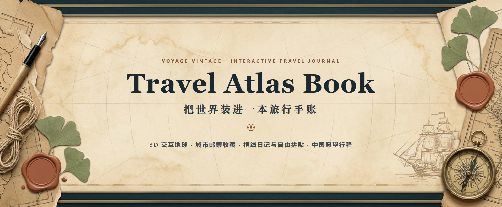
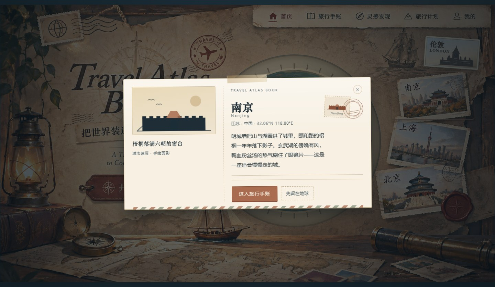
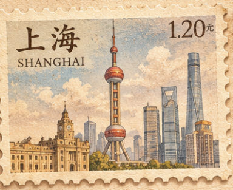
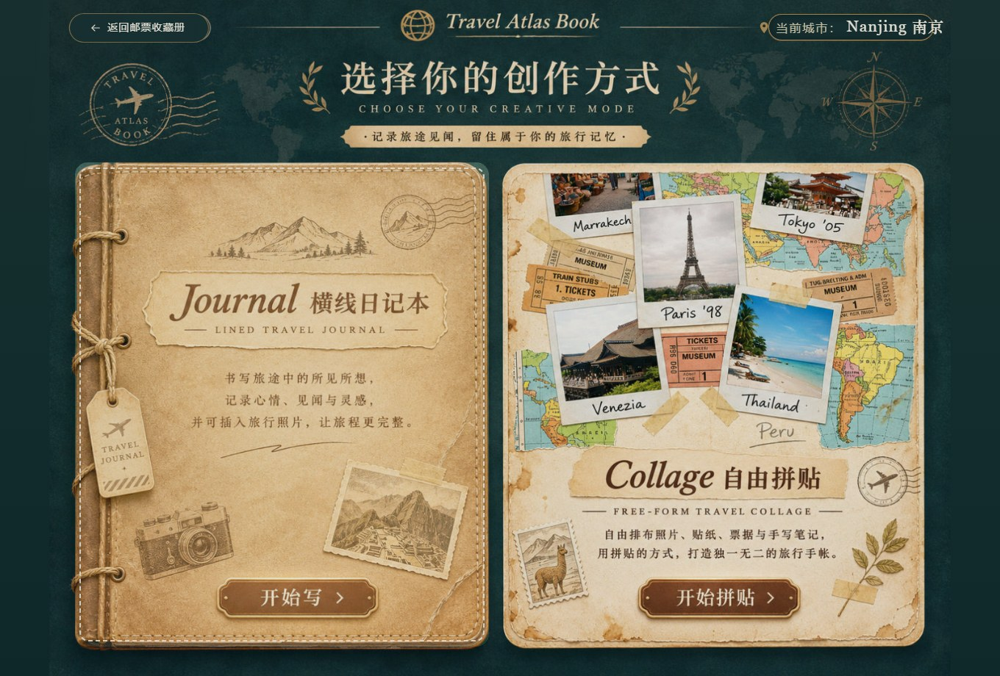
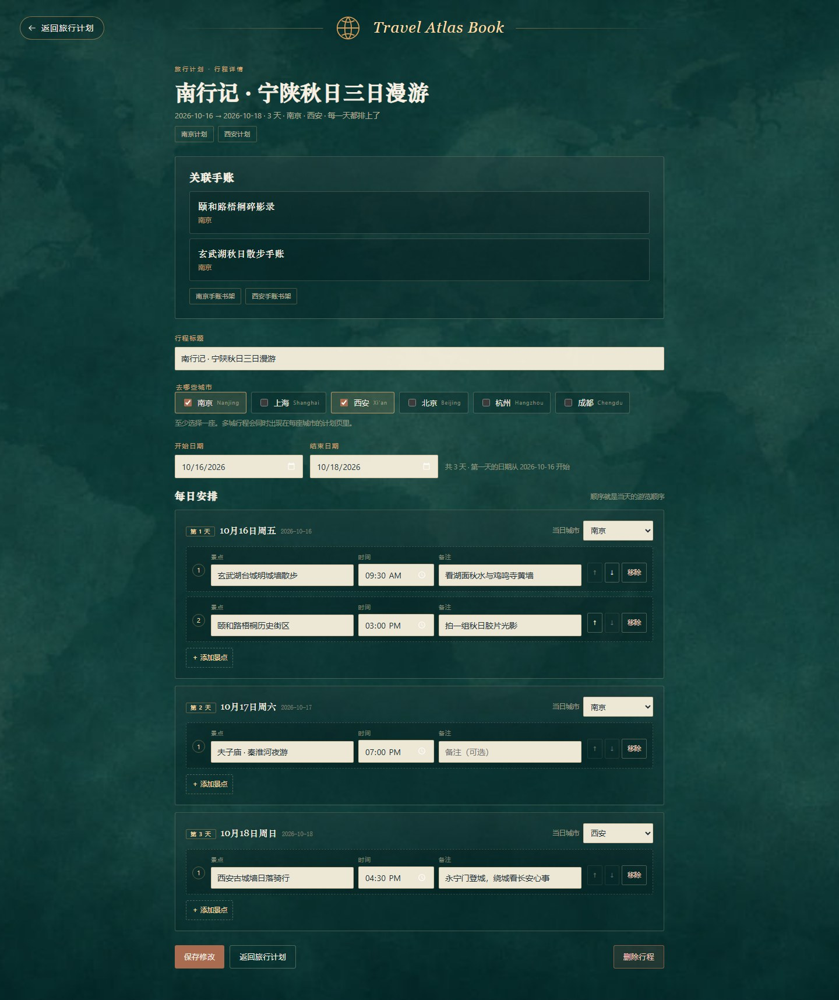
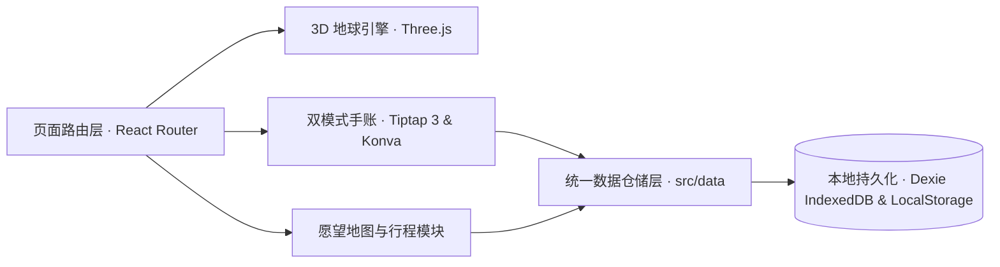

<p align="center">
  
</p>

<p align="center">
  <strong>一本会转的复古旅行手账</strong><br />
  <sub>融合 3D 地球探索、城市邮票收藏、旅行手账与行程规划的交互式 Web 应用</sub>
</p>

<p align="center">
  
  
  
  
  
</p>

<p align="center">
  <a href="#探索世界">探索世界</a> ·
  <a href="#收藏城市">收藏城市</a> ·
  <a href="#记录旅途">记录旅途</a> ·
  <a href="#规划下一站">规划下一站</a> ·
  <a href="#技术架构">技术架构</a> ·
  <a href="#快速开始">快速开始</a> ·
  <a href="#团队介绍">团队介绍</a>
</p>

<p align="center">
  
</p>

**Travel Atlas Book** 以 *Voyage Vintage* 复古航海手账为视觉语言，在浏览器本地构建起一条完整的旅行记忆工作流：

> 转动 3D 地球 → 翻开城市明信片 → 收集城市邮票并新建手账 → 在横线日记或自由拼贴中记录旅途 → 用中国愿望地图规划下一站，并与手账双向关联。

目前应用处于 **V1** 阶段（核心功能与本地持久化已完成，**尚未公开发布线上体验地址**，支持本地构建与离线静态运行）。

<p align="center">
  
</p>

## 探索世界

首页将 Three.js 渲染的 3D 地球直接嵌入复古手绘桌案之中，保留帆船、油灯与光影层次。程序化绘制的油画质感球面支持自由拖拽旋转、阻尼缩放与点击图钉飞向城市；当浏览器不支持 WebGL 时自动降级为城市快捷列表。

<p align="center">
  
  <br />
  <sub>首页桌面端实景舞台：可交互 3D 地球、顶部缎带导航与明信片快捷入口</sub>
</p>

点击地球上的城市图钉、右侧明信片或「开始探索」按钮，镜头平滑转向目标城市并翻开复古明信片，展示手绘地标剪影、邮戳与城市手记，一键直达该城市的手账书架。

<p align="center">
  
  <br />
  <sub>南京城市明信片弹层：展示手绘剪影、坐标邮戳与城市手账入口</sub>
</p>

<p align="center">
  
</p>

## 收藏城市

系统围绕**南京、上海、西安、北京、杭州、成都**六座城市构建统一的邮票画廊、专属文化贴纸与城市门户（地球与明信片同时保留**伦敦**探索入口）。点击邮票即可展开该城手账书架，并由用户显式盖下收藏章以留存首次收集日期。

<table width="100%">
  <tr>
    <td align="center" width="33%">
      <br />
      <strong>南京</strong> · <sub>明城墙</sub>
    </td>
    <td align="center" width="33%">
      <br />
      <strong>上海</strong> · <sub>旧外滩</sub>
    </td>
    <td align="center" width="33%">
      <br />
      <strong>西安</strong> · <sub>大雁塔</sub>
    </td>
  </tr>
  <tr>
    <td align="center" width="33%">
      <br />
      <strong>北京</strong> · <sub>天坛中轴</sub>
    </td>
    <td align="center" width="33%">
      <br />
      <strong>杭州</strong> · <sub>西湖断桥</sub>
    </td>
    <td align="center" width="33%">
      <br />
      <strong>成都</strong> · <sub>宽窄巷子</sub>
    </td>
  </tr>
</table>

<p align="center">
  
  <br />
  <sub>牛皮纸邮票收藏册：点亮已藏印章日期，下方展开城市手账书架与计划入口</sub>
</p>

<p align="center">
  
</p>

## 记录旅途

同一本手账支持在创作模式选择页自由进入 **Journal 横线日记本** 与 **Collage 宽幅自由拼贴**，两套内容独立持久化，共享标题、本地上传照片与城市文化贴纸库。

<table width="100%">
  <tr>
    <th align="center" width="50%">Journal · 横线日记本</th>
    <th align="center" width="50%">Collage · 自由拼贴</th>
  </tr>
  <tr>
    <td valign="top" width="50%">
      
      <p>基于 Tiptap 定制，文字贴合手绘纸面横线排布，支持行内照片、自由贴纸装饰、基础格式工具与自动保存恢复。</p>
    </td>
    <td valign="top" width="50%">
      
      <p>基于 React Konva 构建固定比例宽幅画布，支持照片、胶带贴纸与楷体文字自由拖拽、旋转缩放、画布缩放控制与图层排序。</p>
    </td>
  </tr>
</table>

<p align="center">
  
  <br />
  <sub>创作方式选择页：同一本手账可随时切换横线日记或自由拼贴模式</sub>
</p>

<p align="center">
  
</p>

## 规划下一站

在内置的中国愿望地图上点亮想去城市的愿望星标与旅行备忘，按自然日编排单城或多城行程，并可在编辑器与行程详情页之间双向绑定、互查关联手账。

<table width="100%">
  <tr>
    <th align="center" width="50%">中国愿望地图</th>
    <th align="center" width="50%">行程规划与手账联动</th>
  </tr>
  <tr>
    <td valign="top" width="50%">
      
      <p>本地矢量底图离线可用，记录城市愿望备注并即时点亮地图星标。</p>
    </td>
    <td valign="top" width="50%">
      
      <p>按天规划景点与时间，实时列出关联手账并支持一键回看对应书页。</p>
    </td>
  </tr>
</table>

<p align="center">
  
  <br />
  <sub>移动端自适应布局：竖版 3D 地球首页、移动端自由拼贴工作区与愿望地图</sub>
</p>

<p align="center">
  
</p>

## 技术架构

应用为纯前端模块化架构，所有地图、地球贴图与贴纸资源随静态产物本地打包，用户数据与照片通过 IndexedDB 与 LocalStorage 闭环保存于当前浏览器，按编辑模式延迟加载编辑器代码。



详细的技术选型版本、像素热区坐标量测、球体渲染原理、并发写保护及扩展接入点，见 [技术实现与扩展指南](docs/technical-architecture.md) 与 [V1 公共数据与路由契约](docs/v1/contracts.md)。

<p align="center">
  
</p>

## 快速开始

需准备 **Node.js `>= 22.0.0`**。目前**尚未公开发布线上站点**，可通过以下方式在本地运行或静态离线体验：

```bash
npm ci           # 安装依赖
npm run dev      # 开发预览 (:5173)
npm run build    # 构建产物 (dist/)
npm run preview  # 本地预览 (:4173)
```

本地离线静态运行脚本（`demo:backup` / `demo:local`）以及测试、素材生成命令，请查阅 [技术实现与扩展指南](docs/technical-architecture.md) 与 [V1 发布与演示说明](docs/v1/release.md)。

<p align="center">
  
</p>

## 团队介绍

### 核心团队

<table>
  <tr>
    <td align="center" width="50%">
      <a href="https://github.com/xiaoguijj">
        <br />
        <strong>@xiaoguijj</strong>
      </a><br />
      <sub>视觉主题与内页布局 · 城市邮票与文化贴纸系统 · Journal 横线日记本与贴纸图层</sub>
    </td>
    <td align="center" width="50%">
      <a href="https://github.com/goodluck55k">
        <br />
        <strong>@goodluck55k</strong>
      </a><br />
      <sub>数据契约与本地存储 · 手账壳 · 自由拼贴 · 愿望地图与行程联动</sub>
    </td>
  </tr>
</table>

### 其他贡献者

<table>
  <tr>
    <td align="center">
      <a href="https://github.com/hvemil9">
        <br />
        <strong>@hvemil9</strong>
      </a><br />
      <sub>首页地球城市聚焦与明信片转场基础实现</sub>
    </td>
  </tr>
</table>

<p align="center">
  
</p>

## 文档索引与数据说明

- **工程与设计文档**：[技术实现与扩展指南](docs/technical-architecture.md) · [V1 技术方案](docs/Travel-Atlas-Book-V1.md) · [V1 正式开发规划](docs/Travel-Atlas-Book-V1-Development-Plan.md) · [V1 公共契约](docs/v1/contracts.md) · [发布与演示说明](docs/v1/release.md) · [素材登记](docs/v1/design/assets.md)
- **数据与授权**：世界陆地轮廓源自 [Natural Earth](https://www.naturalearthdata.com/)（Public Domain）并经 `world-atlas`（ISC）解码；字体使用系统内置字体栈；首页与手账原图由需求方提供，公开发布前需再次确认授权使用范围。
