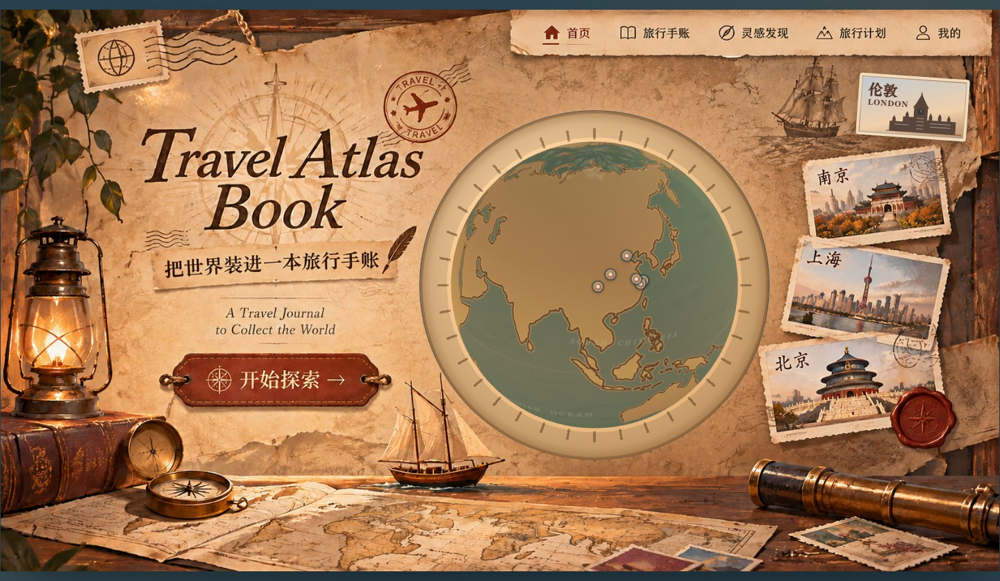
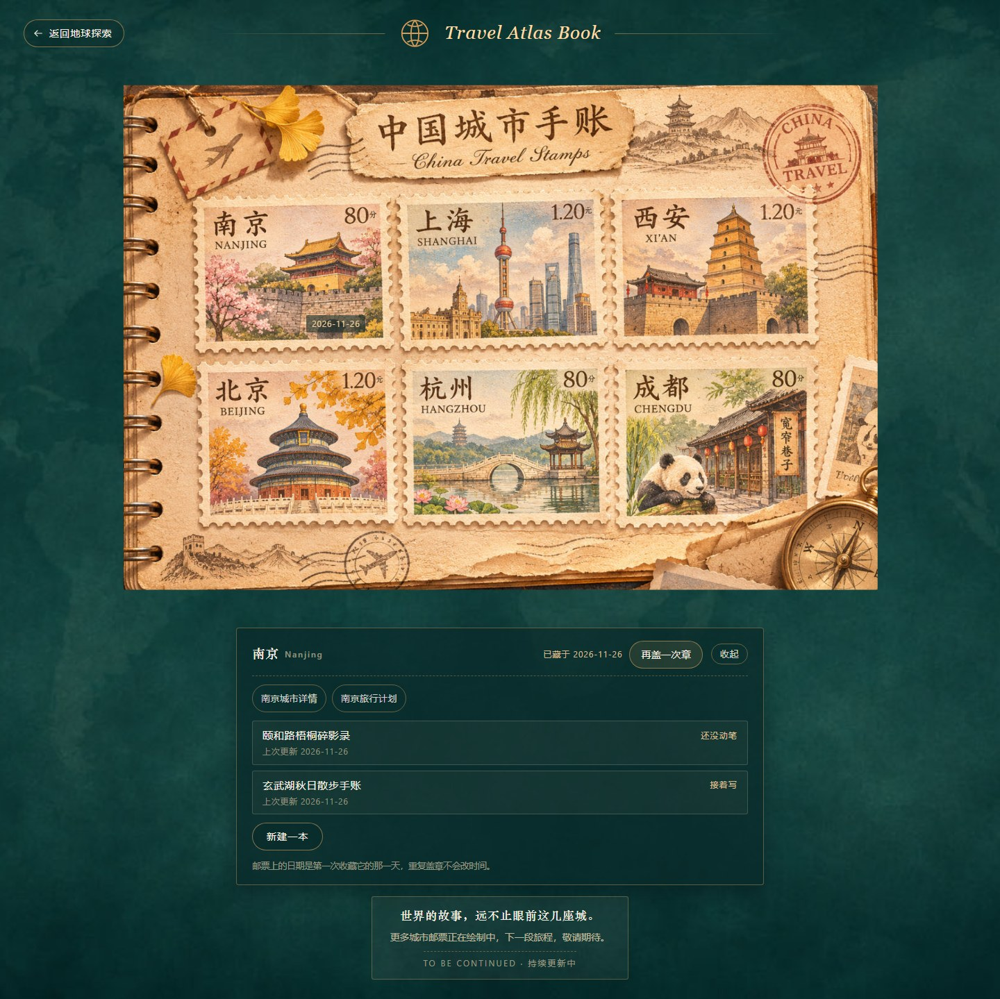
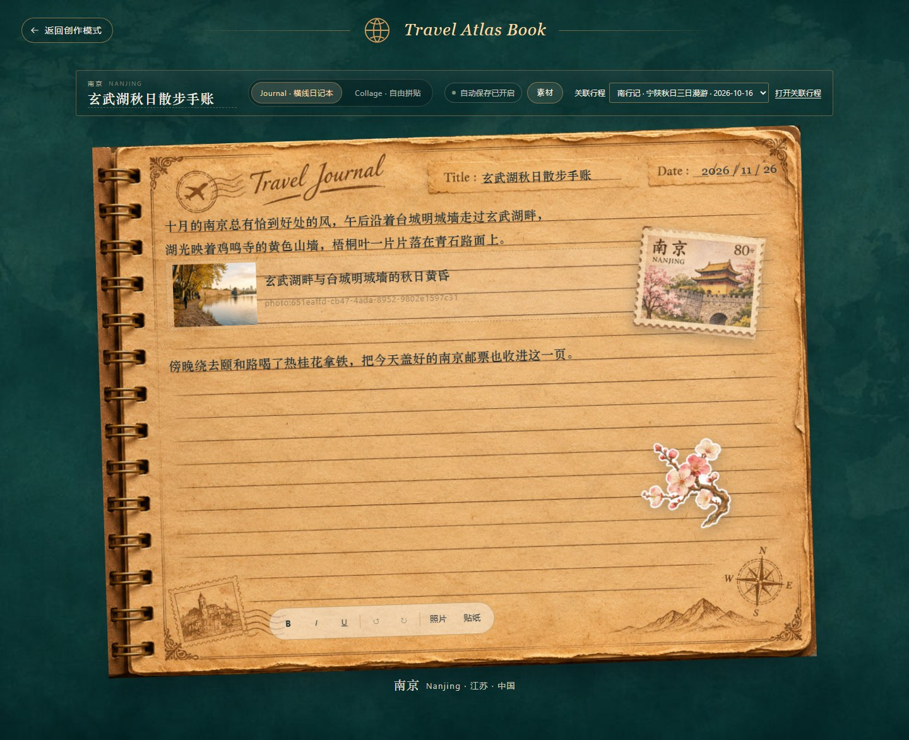
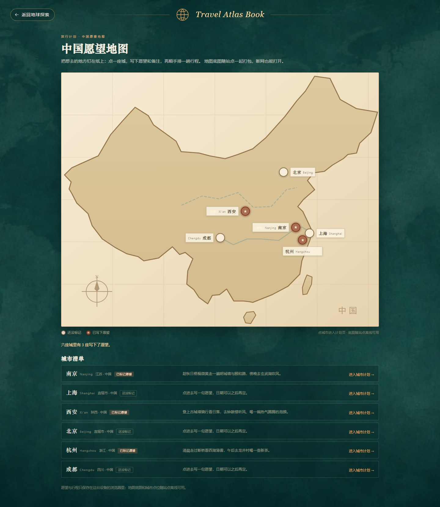
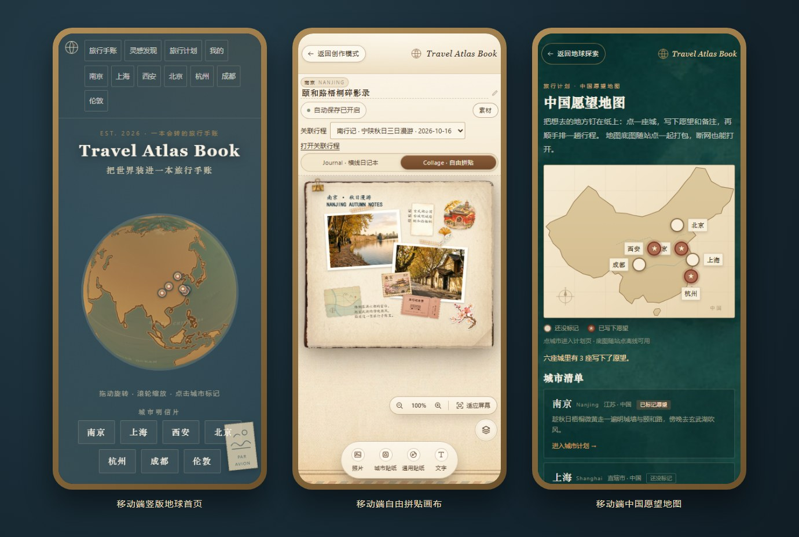
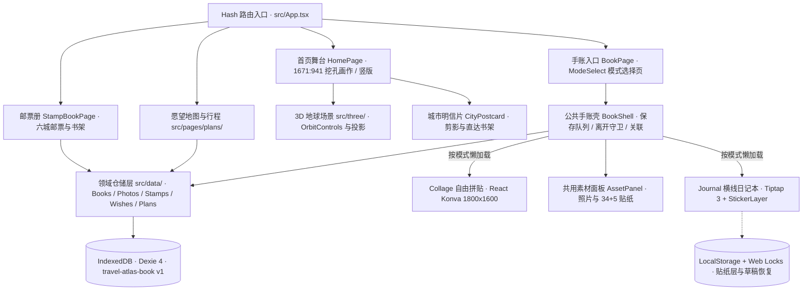

<p align="center">
  
</p>

<p align="center">
  <strong>一本会转的复古旅行手账</strong><br />
  <sub>Voyage Vintage · 3D 交互地球 · 六城邮票收藏 · 横线图文日记 · 宽幅自由拼贴 · 中国愿望行程联动</sub>
</p>

<p align="center">
  <a href="#项目介绍">项目介绍</a> ·
  <a href="#核心功能与实拍展示">核心功能与实拍</a> ·
  <a href="#技术架构">技术架构</a> ·
  <a href="#快速开始">快速开始</a> ·
  <a href="#团队介绍">团队介绍</a> ·
  <a href="#项目文档与版权说明">文档索引</a>
</p>

<p align="center">
  
</p>

## 项目介绍

**Travel Atlas Book** 是一款融合 **3D 地球探索、城市邮票收藏、旅行手账与行程规划**的交互式 Web 应用。作品以复古手绘旅行手账为视觉载体，将传统纸质手账的翻阅仪式感与现代浏览器交互结合，在本地构建起一条完整的旅行记录工作流：

> 转动桌案上的地球 → 翻开城市复古明信片 → 在邮票册盖章建本 → 用横线日记本写下见闻，或切换到宽幅画布自由拼贴 → 在中国愿望地图上规划行程，并把手账直接关联到每一趟旅途。

### 设计理念

- **Voyage Vintage 复古视觉系统**：全站色板由午夜蓝（`#263F4B`）、深海青（`#182B36`）、旧纸黄（`#E8D9B8`）、奶油纸（`#F7F0E3`）、陶土红（`#A96C50`）、鼠尾草绿（`#84917A`）与黄铜色（`#B08D57`）统一驱动，CSS Modules 与 Three.js 球体材质共用同一份 Theme Token。
- **整画实景与像素级热区对位**：首页桌案、邮票收藏册、创作模式选择页与横线日记本均采用整幅插画背景，所有按钮、邮票、输入框与行距通过源图像素坐标换算为百分比及容器查询单位（`cqw`）精准叠合，保留手绘光影与纸张肌理。
- **Local-First 离线可用**：地球油画贴图、中国地图底图、39 枚本地贴纸以及基于 IndexedDB（Dexie 4）的手账与行程仓储全部闭环于浏览器端，断网环境下依然可完整创作与本地运行。

> **V1 版本状态**：V1 核心功能开发、类型检查、Vitest 单元测试与 Playwright 端到端回归均已完成；目前**尚未公开发布线上体验地址**，支持通过生产构建产物一键启动本地静态服务体验。

<p align="center">
  
</p>

## 核心功能与实拍展示

以下页面均由当前仓库最新 `main` 生产构建在本地 Chromium 环境下运行并真实截取。

### 1. 3D 交互地球与城市明信片

首页桌案将一尊由 **Three.js** 渲染的 3D 地球通过 **5 层 `z-index` 分层与 CSS `mask-image` 挖孔遮罩**嵌入复古插画之中：帆船桅杆、云层与暖光轮廓保持原有前景遮挡关系，球体在孔内真实可转、可缩放。

- **程序化油画地球贴图**：不依赖外部卫星瓦片请求，基于 Natural Earth 陆地轮廓与固定随机种子在 Canvas 2D 现场绘制等距圆柱投影洋流笔触、经纬网格、极地冰盖与复古海洋标注。
- **物理阻尼与图钉消歧**：支持拖拽惯性、松手 `1.2s` 恢复自转、四元数飞向城市（`1.15s`），针对南京与上海等邻近图钉按按下原点距离精准拾取（鼠标 `18px` / 触屏 `28px`）。
- **无 WebGL 降级退路**：当硬件加速或 WebGL 不可用时自动切换为可点击的城市入口列表，核心链路不中断。

<p align="center">
  
  <br />
  <sub>首页桌面端实景舞台：3D 地球嵌入桌案圆孔，保留帆船前景、油灯暖光、缎带导航与三张明信片热区</sub>
</p>

点击地球图钉、右侧明信片或左下「开始探索」按钮，镜头平滑飞向对应城市并从图钉原点弹开双栏复古明信片，展示城市手绘剪影、邮戳、经纬度坐标与城市手记，一键直达该城市的手账书架。

<p align="center">
  
  <br />
  <sub>南京城市明信片弹层：手绘明城墙剪影、POSTED ON THE GLOBE 邮戳与直达书架入口</sub>
</p>

---

### 2. 六座城市探索

系统围绕同一份静态城市目录（`src/data/cities.ts`）构建六座核心业务城市，从地球图钉、明信片、邮票收藏册、专属文化贴纸到愿望地图全面打通；同时在地球与明信片保留 **伦敦（London）** 探索与建本入口。每座城市拥有独立的档案门户页（`/#/city/:cityId`），双向串联手账书架与城市旅行计划。

<p align="center">
  
  
  
  
  
  
</p>

| 城市 | 地标与城市印象 | 专属贴纸与风物（部分复用展示） |
| --- | --- | --- |
| **南京** `Nanjing` | 明城墙与玄武湖入画，「梧桐落满六朝的窗台」 |   鸡鸣寺 · 鸭血粉丝汤 · 梅花 · 南京云锦 |
| **上海** `Shanghai` | 苏州河晨雾与外滩天际线，「江风把旧外滩吹得很亮」 |   武康大楼 · 海派旗袍 · 生煎包 · 白玉兰 |
| **西安** `Xi'an` | 方正城墙与晨钟暮鼓，「钟声落在城墙里面」 |   大雁塔 · 兵马俑 · 羊肉泡馍 · 石榴花 |
| **北京** `Beijing` | 中轴线屋脊与天坛圆廓，「中轴线上的鸽哨与砖灰」 |   地坛 · 京剧 · 北京烤鸭 · 菊花 |
| **杭州** `Hangzhou` | 断桥柳色与龙井茶香，「断桥的雪还没化完」 |   雷峰塔 · 西湖绸伞 · 东坡肉 · 桂花 |
| **成都** `Chengdu` | 青石板巷与竹椅茶馆，「巷子深处挂着红灯笼」 |   武侯祠 · 川剧 · 担担面 · 蜀绣 |

---

### 3. 城市邮票收藏与创作模式选择

牛皮纸装订册《中国城市手账》陈列六城邮票（齿孔内侧精准热区）。点开任意邮票可展开该城手账书架，支持新建多本手账、查看创作进度，并由用户显式执行「**盖下这枚收藏章**」——数据库以 `stampId` 为主键永久留存首次收藏日期，重复盖章不会篡改初遇时间。

<p align="center">
  
  <br />
  <sub>六城邮票收藏册：南京邮票已盖上 `2026-11-26` 收藏日期章，下方展开南京手账书架与城市联动入口</sub>
</p>

每一本手账（共享同一个 `bookId`）均可在「创作方式选择页」自由切换 **Journal 横线日记本** 与 **Collage 自由拼贴**，两套内容独立存档、共用标题与城市素材库。

<p align="center">
  
  <br />
  <sub>创作方式选择页：实时替换当前城市胶囊，提供横线日记本与自由拼贴双入口</sub>
</p>

---

### 4. Journal 横线日记本

Journal 模式基于 **Tiptap 3** 定制，围绕纸面实景图片（`1448×1086`）测量 17 条印刷横线位置，以 `47.6px` 基准行高换算 `cqw` 单位锁定正文排版，使中文字符稳稳落在纸线上。

- **图文混排与资产隔离**：内置 `atlasMedia` 块节点，正文中仅保存 `assetId` 与可选图注；本地照片经前端解码缩放（单图源文件上限 `10 MB`、最长边 `1600 px`）存入 IndexedDB 并按生命周期自动创建/释放 Object URL。
- **独立贴纸层与恢复保护**：支持在横线纸页上自由粘贴、拖拽、旋转与缩放 34 张共享贴纸（全域小集、六城邮票与 24 张城市文化贴纸），并通过跨标签页写锁及 `pagehide` 关页草稿恢复机制防止数据丢失。

<p align="center">
  
  <br />
  <sub>Journal 横线日记本：自动回填标题与本地日期，正文贴合纸线，支持行内照片、自由贴纸、格式工具栏与行程关联</sub>
</p>

---

### 5. Collage 宽幅自由拼贴

Collage 模式基于 **React Konva 18 + Konva 10** 打造，提供固定的 `1800×1600` 宽幅逻辑画布（自动居中兼容迁移早期的 `1200×1600` 作品），避免不同分辨率屏幕下元素坐标跑偏。

- **素材与纸品工坊**：除共享本城照片与 34 张通用/城市贴纸外，额外集成 **5 张拼贴专属装饰贴纸**（格子纸胶带、手账撕纸便签、复古旅行票根、手绘地图碎片、银杏叶）以及可自定义字号、颜色、对齐与粗斜体的楷体文字元素。
- **画布缩放与图层检查器**：桌面端配备底部缩放控制条（`50%–200%` 步进缩放、`Ctrl/Cmd + 滚轮` 缩放与一键「适应屏幕」），选中元素弹出浮动操作条并联动右侧图层列表，支持置顶、上移、下移、置底与角度/比例精细微调。

<p align="center">
  
  <br />
  <sub>Collage 宽幅自由拼贴：1800×1600 逻辑画布、照片拍立得边框、多类型贴纸叠加、左侧工具轨与右下角缩放控制</sub>
</p>

---

### 6. 旅行愿望地图与行程规划

「旅行计划」栏目提供基于本地矢量底图（`china-outline.svg`）的**中国愿望地图**：底层与地球采用统一等距圆柱投影边界，并在窄屏视口对密集的南京、上海、杭州点位进行互让偏移处理，确保桌面与手机端都能精准点选。

- **愿望星标与备忘**：在任意城市计划页保存愿望与备注即可点亮地图星标（★），愿望可先于具体日期单独存在，移除愿望不会影响已有行程或手账。
- **多城日程与影响预览**：支持新建单城或多城行程（最长 30 天）、按自然日分组编排每日景点/时间/备注及同日上下调序；缩短日期或移除城市前先展示受影响日程与手账清单，用户确认后在同一事务内原子更新。

<p align="center">
  
  <br />
  <sub>中国愿望地图：点亮南京、西安、杭州三城愿望星标，下方卡片同步汇总各地旅行备忘</sub>
</p>

---

### 7. 手账与旅行计划联动

手账与行程在仓储层通过 `planId` 建立双向可信关联，跨实体变更统一运行于 Dexie 读写事务之中：

- **书壳内绑定行程**：在 Journal 或 Collage 顶部工具栏直接选择同城行程（仓储自动拦截跨城无效绑定），点击「打开关联行程」即可跳转至对应计划详情页。
- **行程详情实时回看**：行程详情页通过 Dexie `liveQuery` 实时列出所有关联手账并直达该书的模式选择页；若行程删除或移除了某座城市，事务自动解除相关 `planId` 并完整保留手账正文与拼贴内容。

<p align="center">
  
  <br />
  <sub>多城行程详情页：上方「关联手账」实时列出两本关联的南京手账，下方按天编排宁陕三日行程</sub>
</p>

---

### 8. 桌面与移动端自适应实拍

首页在窄屏（`< 760×430`）或不支持容器查询单位 `cqw` 遮罩时自动退回竖版布局；内页、自由拼贴工作区与愿望地图均在 `390×844` 移动端视口下完成自适应排布（Collage 提供底部贴靠工具栏与图层浮层）。

<p align="center">
  
  <br />
  <sub>390×844 真实移动端实拍：竖版 3D 地球首页、移动端自由拼贴画布、移动端中国愿望地图</sub>
</p>

<p align="center">
  
</p>

## 技术架构

### 核心技术栈

| 层面 | 技术选型 | 版本 | 在项目中的职责 |
| --- | --- | --- | --- |
| 应用底座 | React + TypeScript + Vite | `18.3.1` / `5.6.3` / `5.4.11` | 模块化单页应用构建，`base: './'` 支持根路径与子路径静态托管 |
| 路由系统 | React Router DOM | `6.28.0` | `createHashRouter` 管理深链（如 `/#/book/:bookId?mode=collage`），无需服务端 rewrite |
| 3D 地球 | Three.js | `0.169.0` | 球体渲染、`OrbitControls`、`CanvasTexture` 程序化油画地球、独立分包 |
| 日记编辑器 | Tiptap 3（Core / React / PM / StarterKit） | `3.35.0` | 横线日记富文本编辑、自定义 `atlasMedia` 节点与 JSON 持久化 |
| 拼贴画布 | React Konva + Konva | `18.2.14` / `10.10.0` | `1800×1600` 矢量/位图拼贴舞台、`Transformer` 变换与图层顺序管理 |
| 本地存储 | Dexie | `4.4.7` | IndexedDB 五表模型（`books`/`photos`/`stamps`/`wishes`/`plans`）与跨表事务 |
| 工程测试 | Vitest + fake-indexeddb + Playwright | `3.2.4` / `6.2.8` / `1.65.1` | 仓储与模型单测、Chromium 全链路 E2E 回归（另含构建期脚本工具 `Jimp 0.22.12`） |

### 系统分层架构



### 工程亮点与设计边界

- **按模式懒加载与独立分包**：首页首屏不加载 Tiptap 与 Konva 代码；`Three.js`、`JournalView`、`CollageView` 均拆分为独立 Chunk，首屏主包 gzip 约 `193.75 kB`。
- **并发写保护与零静默丢失**：手账壳采用防抖保存队列与前置条件校验，若其他标签页并发修改正文或拼贴，当前页保留草稿并支持「另存为副本」；贴纸系统通过跨标签页写锁与 `.pending` 草稿恢复确保断电或误关页可人工裁决恢复。
- **严谨边界**：更多像素坐标量测算法、地球相机反算公式、构建产物体积与扩展接入点，已完整迁移整理至 [技术实现与扩展指南](docs/technical-architecture.md)。

<p align="center">
  
</p>

## 快速开始

### 环境要求

- **Node.js `>= 22.0.0`**（已在 Node 22 PR CI 与本地 Node 24 环境下验证）

### 安装、开发与构建

```bash
# 1. 安装锁定依赖
npm ci

# 2. 启动本地开发服务器（默认 http://localhost:5173）
npm run dev

# 3. 类型检查与生产构建（输出至 dist/）
npm run typecheck
npm run build

# 4. 本地预览生产构建（默认 http://localhost:4173）
npm run preview
```

### 本地离线运行（适合断网环境体验）

应用采用 `base: './'` 与 Hash 路由，可零配置运行于任意本地静态服务或子路径：

```bash
# 构建并生成离线备份目录 demo/current/（上一版本保留于 demo/previous/）
npm run demo:backup

# 启动固定端口离线演示服务（固定 127.0.0.1:4173 以保留本机 IndexedDB 存档）
npm run demo:local -- --dist demo/current

# 如需模拟 /atlas/ 子路径静态部署：
node scripts/serve-dist.mjs --dist demo/current --base-path /atlas --port 4175
```

### 测试与素材构建脚本速查

| 命令 | 说明 |
| --- | --- |
| `npm test` | 运行 Vitest 单元测试（纯 Node 环境，无需浏览器） |
| `npm run test:e2e` | 执行生产构建并运行完整 Playwright Chromium 端到端测试 |
| `npm run test:static` | 运行根路径与 `/atlas` 子路径静态部署专项回归 |
| `npm run data:world` | 联网重新从 `world-atlas` 解码生成 `src/data/world.ts` 陆地轮廓 |
| `npm run data:hero` / `data:inner` / `data:paper` / `data:collage` / `data:stickers` | 从 `assets-source/`（或贴纸源包）重新生成优化后的运行时图片资源 |

<p align="center">
  
</p>

## 团队介绍

成员信息严格依据本仓库实际 Git 提交记录与 GitHub 贡献者历史整理：

| GitHub 账号 | 在项目中负责的核心模块与交付 |
| --- | --- |
| [@xiaoguijj](https://github.com/xiaoguijj) | 项目初始化与 *Voyage Vintage* 视觉基线、内页深海地图背景与公共顶栏（V1-03）、六城邮票与 34 张文化贴纸目录（V1-04）、城市邮票收藏册与书架（V1-06）、Journal 横线日记本（V1-07）及通用贴纸系统（PR #13 / #16） |
| [@goodluck55k](https://github.com/goodluck55k) | 首页 3D 地球主链路与惯性修复（V1-01 / PR #15）、公共数据契约与 Dexie 持久化底座（V1-02）、V1 进度看板与协作规范、手账壳与模式选择页（V1-05）、Collage 自由拼贴与宽幅缩放优化（V1-08A / V1-08B / PR #22）、中国愿望地图与行程规划（V1-09）、跨模块联动（V1-10）及集成发布验收（V1-11） |
| [@hvemil9](https://github.com/hvemil9) | 首页地球点击飞往城市与复古明信片展开转场基线实现（PR #1） |

<p align="center">
  
</p>

## 项目文档与版权说明

### 相关文档索引

- [技术实现与扩展指南](docs/technical-architecture.md)：首页 5 层遮罩坐标、Three.js 相机控制、构建产物明细与后续扩展接入点
- [V1 正式开发规划](docs/Travel-Atlas-Book-V1-Development-Plan.md)：11 项 V1 分支任务、依赖拓扑、路由契约与验收矩阵
- [V1 技术调研与方案](docs/Travel-Atlas-Book-V1.md)：技术选型依据、开源调研对比与数据模型设计
- [V1 公共数据与路由契约](docs/v1/contracts.md)：Dexie Schema、Error Code、ID 规则与编辑器接口冻结文档
- [V1-11 发布与演示说明](docs/v1/release.md)：静态部署流程、现场演示主路径、已知限制与发布检查清单
- [V1-04 素材与来源登记](docs/v1/design/assets.md) & [贴纸系统说明](src/stickers/README.md) & [双人协作说明](docs/v1/collaboration.md)

### 数据来源与授权声明

- **世界陆地轮廓**：取自 [Natural Earth](https://www.naturalearthdata.com/) 1:110m Cultural（Public Domain），经 `world-atlas@2.0.2`（ISC 许可）解码生成本地静态坐标。
- **内联矢量与字体**：城市地标剪影、邮戳、中国轮廓底图与装饰线均由仓库内自行绘制；字体采用系统内置衬线与无衬线字体栈，不加载任何第三方网络字体。
- **背景原图授权提示**：`assets-source/home-hero.png` 等手账底图由需求方提供，其中首页背景画著作财产权归原提供方所有，对外公开发布前需再次确认授权使用范围；当前未发现其他版权不明的第三方资源。
