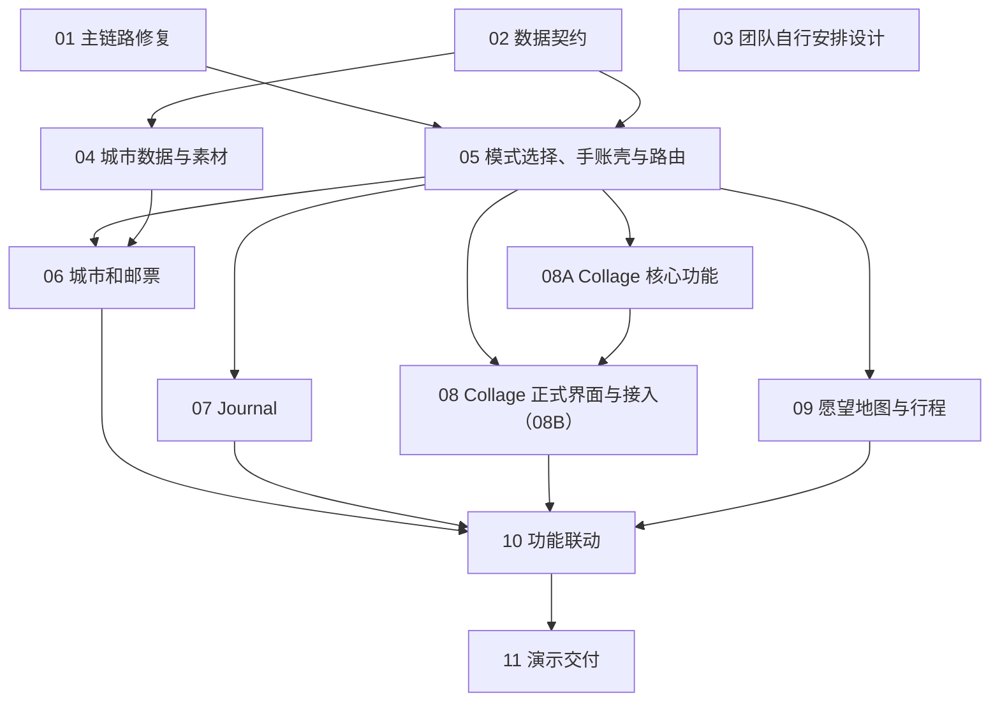

# Travel Atlas Book V1 整体开发规划与分支任务

2026 年 11 月 22 日 · 六城版 · 双人协作正式执行版 · 基线 `main@11bcd96`

**开工顺序**　先修首页链路，并行冻结数据和路由契约。V1-05 集中注册路由，V1-06 实现邮票册，V1-09 实现愿望地图和行程，V1-10/11 完成功能联动和验收。

## 1. 仓库核对与复用决策

以当前 `main` 的文件树和转场 PR 为基线。前期调研已记录 `npm ci`、生产构建和模拟 DOM 路由检查的结果，实施和交付统一使用 Node 22。真实 WebGL 与触屏操作按第 8 节验收。技术选型和调研证据见 [V1 技术方案](Travel-Atlas-Book-V1.md)。

| 对象 | 已核对的现状 | V1 接手方式 |
| --- | --- | --- |
| `main` | `11bcd966ed19b3f96704b9fd67b5e3b4f0a21784`。远端默认分支，已合并首页转场。 | 以此为起点，沿用 React 18、Three.js、Vite、Hash 路由、CSS Modules 及现有目录。 |
| 首页转场 PR #1 | 已合并提交 `71b88eaea3c97da25df23cd77250adbd8c076cab`，含 Hook 修复、到达回调、图钉反馈、明信片展开、球体取景与贴图调整，并加入伦敦。 | V1-01 在合并后的实现上验证遮罩、取景和交互。先用南京、上海、北京回归，V1-04 补齐六城范围后由 V1-11 验收。伦敦为基线的额外城市，保留其已有入口，六城业务范围见第 2 节。 |
| PR 与合并 | 已有的首页转场合并至 `main`。 | 后续新建编号分支并向 `main` 提 PR，实行队友互审。是否启用仓库分支保护由团队自行决定。 |
| 首页与探索 | 基线已实现地球旋转、缩放、城市图钉和最近命中。WebGL 失败时可通过城市按钮操作。 | 复用 `HomePage`、`Globe`、`createGlobeScene`、`CityPostcard`。首页提供六城选城能力，继续由页面处理路由。 |
| 城市与栏目 | `CityPage` 已有城市封面、地标、坐标与无效 ID 退路，正文是待办。基线的旅行手账栏目为城市目录，旅行计划为规划文案。 | 六城邮票册成为旅行手账入口。每座城市继续沿用原城市 URL 承载该城手账列表。旅行计划栏目进入中国愿望地图。 |
| 数据与编辑器 | `cities.ts` 有静态城市数据，`types.ts` 是现有城市类型。当前树中没有 IndexedDB 存储、上传、收藏、编辑器与计划实现。 | 复用城市 ID、`getCityById`、`CityMotif`。新增 Dexie 和业务模块，继续由静态目录提供城市。 |
| 测试、部署与资产 | `build` 做 tsc 与 Vite 打包，`base: './'`，Three.js 独立分包。跟踪树没有测试脚本、部署工作流或项目级 LICENSE。README 记载首页原图由需求方提供，发布使用范围待确认。 | 集中加入轻量测试，验证 Qoder Sites 与本地静态备份。沿用既有地球素材和来源说明，公开发布前确认首页原图及新增演示素材的使用范围。 |

[主分支基线](https://github.com/xiaoguijj/travel-atlas-book/tree/11bcd966ed19b3f96704b9fd67b5e3b4f0a21784) · [首页转场 PR #1](https://github.com/xiaoguijj/travel-atlas-book/pull/1)

## 2. V1 路线图

**比赛演示路径**　地球点南京 → 进入邮票册并定位南京 → 点南京邮票进入该城手账列表 → 盖章、创建或打开一本手账 → 在模式选择页进入 Journal 写字并插入照片与贴纸 → 回到同一本书的模式选择页 → 进入 Collage 复用同一张照片。再点顶部「旅行计划」 → 在中国愿望地图选南京 → 添加旅行愿望与备注 → 新建两日行程并关联该手账 → 刷新后从地图重新打开愿望和行程。用南京、西安另测多城行程与手账归属。

**V1 城市**　南京、上海、西安、北京、杭州、成都。地球、地图、邮票册与城市选择均引用统一城市目录。

### 页面入口与功能

| 点击位置 | 进入位置 | 可做的事 |
| --- | --- | --- |
| 顶部「旅行手账」 | 六城邮票册 | 每城都能进入对应的手账列表，包含未收藏的城市。 |
| 首页地球或快捷入口点城市 | 直接进入同一个邮票册并定位所选城市 | 选中的邮票可直接打开该城手账列表。定位城市不自动盖章或创建手账。现有明信片继续作为单独的城市预览。 |
| 城市手账列表中新建成功或打开已有手账 | 该书的模式选择页 | 选择 Journal 横线日记本或 Collage 自由拼贴。Collage 接入前显示「开发中」。 |
| 顶部「旅行计划」 | 中国愿望地图 | 点六城之一进入该城计划页，添加、编辑或移除愿望标记与备注，再按需新建或打开具体行程。 |
| 城市计划页的「新建行程」或现有行程 | 具体行程编辑 | 编辑日期、每日景点、顺序、时间与备注。已有行程可从地图经城市计划页再次打开。 |

界面的视觉、布局、样式和设计交付由团队自行决定。开发规划以页面入口、用户操作和数据结果为验收依据。

**范围**　纯前端模块化单体。IndexedDB 由 Dexie 4 管理，localStorage 只存轻量偏好。现有城市和栏目 URL 继续可用。Journal 选 Tiptap 3，Collage 选 React Konva 18 与兼容 Konva 10，旅行计划由本地静态中国底图、六城交互点位及 React 日期/行程表单组成。地球继续使用现有 Three.js。社区、账号、后端、云同步、Vlog、主题切换、导出分享、自动航线、季节推荐和同行清单留在后续版本。

| 阶段 | 目标与任务 | 前置依赖 | 完成标准 |
| --- | --- | --- | --- |
| A · 基线修复 | V1-01 修首页进城链路；V1-03 的界面设计由团队自行安排。 | 当前 `main`。 | 首页选城、路由切换和回退可重复操作。 |
| B · 公共底座与素材 | V1-02 冻结数据与路由契约，V1-04 准备六城数据和素材，V1-05 接入模式选择页、公共编辑壳和各入口。 | V1-02 与 A 可重叠，V1-04 与 V1-05 可并行。 | 愿望与行程有独立存储模型。南京可建两本书并分别进入模式选择页，照片与两种样例内容可保存并重开恢复。 |
| C · 功能实现 | V1-06 实现邮票册和城市书架，V1-07/08 实现两个编辑器，V1-09 实现愿望地图、城市计划及每日行程。 | 按第 4、5 节并行开工和合并。 | 六城邮票和地图入口都可操作，愿望与行程各自刷新恢复，两种编辑器分别上手。 |
| D · 联动与交付 | V1-10 接城市、手账、计划和栏目入口，V1-11 做集成验收和静态演示。 | V1-10 等各功能合并。V1-11 可提前写用例和走台稿，最终验收等 V1-10。 | 完整演示连续两次走通，线上和本地静态备份可用，主持机和真实触屏设备均完成实测。 |

## 3. 开工前冻结的公共契约

以下路径和页面行为为 V1 统一约定。V1-02 将路由及实际接口签名记录进 `docs/v1/contracts.md`，各分支按该契约对接。模式视图接口在 V1-02 确认，由 V1-05 实装。

### 3.1 路由与入口

路由表统一在 `src/App.tsx`。内部链接交给现有 Router，查询参数在 Hash 内，例如 `/#/book/abc?mode=collage`。路径使用 ID，页面查询实际记录，手账的查询参数指定编辑模式。统一路径构造函数可放 `src/config/routes.ts`。

| URL（省略 `/#`） | 页面和行为 | 接入任务 |
| --- | --- | --- |
| `/`、`/city/:cityId` | 首页地球图钉和城市快捷入口点击后进入带 `cityId` 的邮票册。城市详情仍承载该城手账列表和原有城市深链，明信片可单独预览。 | V1-01 修首页和选城交互，V1-06 接城市业务，V1-10 切换选城落点并接城市计划入口。 |
| `/section/journals`、`/section/journals?cityId=nanjing` | 顶部「旅行手账」直达邮票册。带合法 `cityId` 时定位相应邮票，无效参数时显示整册。点击邮票进入 `/city/:cityId`。 | V1-05 注册，V1-06 实现，V1-10 统一导航。 |
| `/stamps` | 原规划路径作为邮票册别名，跳转到 `/section/journals` 并保留有效查询参数。 | V1-05 接路由。 |
| `/book/:bookId` | 模式选择页。城市手账列表新建成功、打开已有手账，以及行程详情打开已关联手账均进入此页。缺省、空值和未知 `mode` 均显示模式选择页。 | V1-05 注册并接入页面，V1-06 接城市手账列表，V1-10 接行程详情。 |
| `/book/:bookId?mode=journal` | 打开同一本书的 Journal 横线日记本，可直接访问或刷新。 | V1-05 接入公共壳，V1-07 接入编辑器。 |
| `/book/:bookId?mode=collage` | 打开同一本书的 Collage 自由拼贴，可直接访问或刷新。V1-08A 通过深链和编辑器导航使用，模式选择页继续显示「开发中」。 | V1-05 提供占位，V1-08A 接入核心编辑器，V1-08B 开放正式入口。 |
| `/section/plans`、`/plan/city/:cityId` | 顶部 「旅行计划」直达中国愿望地图，点城市进入该城计划页。城市计划页展示愿望备注、已有行程和新建入口，未知城市可返回地图。 | V1-05 注册，V1-09 实现，V1-10 统一导航。 |
| `/plan/new?cityId=nanjing`、`/plan/:planId` | 从城市计划页新建时预填城市。保存后切到真实 ID。编辑、退出或删除后可回来源城市计划页，直接打开的链接可回地图。未知计划有明确退路。 | V1-05 注册，V1-09 实现，V1-10 接手账联动。 |
| `/section/inspiration`、`/section/account` | 保留原入口和后续功能说明。 | V1-10 核对文案和链接。 |

三种手账 URL 共用同一个 `bookId` 和手账壳。壳先加载手账及所属城市。无效书 ID 在三种 URL 下都提供返回邮票册的入口。模式选择页可返回对应城市列表，编辑器可回到本书的模式选择页，离开编辑视图时走公共保存队列的待保存处理。两种编辑器继续延迟加载，保留 Three.js 分包。

V1-05 预接邮票册、邮票册别名、愿望地图、城市计划、行程新建和详情。V1-06/09 填写各自入口组件，V1-10 统一首页和各端导航中的跨页链接。模式选择页与 Journal 界面可提前独立实现视觉与基础交互，使用本地 fixtures、组件状态或回调联调。公共路由由 V1-05 接入，数据库和仓储沿用 V1-02，正式保存使用 V1-05 的公共队列。提前开发阶段保持在独立组件内，接入时移除临时接线。

### 3.2 Schema 与数据所有权

| 实体 | 稳定主键、索引及约定 | 读写边界 |
| --- | --- | --- |
| `City` | 南京 `nanjing`、上海 `shanghai`、西安 `xian`、北京 `beijing`、杭州 `hangzhou`、成都 `chengdu`。沿用现有城市字段及经纬度。 | V1-02 冻结 ID，V1-04 在现有 `cities.ts`、`types.ts` 落地，所有模块复用。 |
| `StampDefinition` / `StampCollection` | 静态每城一款，例如 `nanjing-postmark`。Dexie `stamps: 'stampId'`，数据含 `collectedAt`。 | V1-04 提供定义，V1-06 实现收藏仓储。重复请求保持首次时间。 |
| `TravelBook` | Dexie `books: 'id, cityId, planId'`。标题、创建/修改时间，`planId?`、`journal?`、`collage?`。同城可有多本；一本至多关联一个计划。 | V1-02 负责基础仓储、创建和字段级保存，V1-10 负责现有书的关联和解除。 |
| `JournalContent` / `CollageCanvas` | Journal 存 Tiptap JSON 项目媒体块及 `assetId`。Collage 存固定逻辑画布尺寸和元素数组，含坐标、大小、旋转、素材引用或文字；数组从底到顶。 | 各模式只提交自己的内容。DOM、Konva 运行态和临时 URL 留在视图层。 |
| `PhotoAsset` / `StickerDefinition` | Dexie `photos: 'id, cityId'`。照片有 Blob、MIME、尺寸和时间，ID 用 `photo:`。静态贴纸 ID 用 `sticker:`，有城市或通用分类及构建后 URL。 | 照片按城市归档，可被同城多本书和两种模式引用。V1-04 维护贴纸目录，V1-02 实现照片存取，V1-05 提供统一面板和素材查询。 |
| `CityWish` | Dexie `wishes: 'cityId'`。每个城市至多一条，存在即地图已标记，包含可空 `note` 和 `createdAt/updatedAt`。 | V1-02 定义表和标识，V1-09 写入与读取。愿望可早于行程创建，删除标记只删该愿望。 |
| `TravelPlan` | Dexie `plans: 'id, *cityIds'`，一至多座有效城市、起止日期、按天分组的条目数组和时间戳。日期 `YYYY-MM-DD`，时间 `HH:mm`，记录时间 UTC ISO。 | V1-09 负责仓储、日期与城市校验、影响预览以及更新或删除计划时的关联清理。 |

Schema 由 V1-02 在单一 Dexie 实例定义一次。类型入口建议 `src/data/contracts.ts`，现有 `src/data/types.ts` 保留城市类型。建议 V1-02 同时确认数据库名、v1 表定义、初始画布尺寸、Journal 媒体节点名称、日期序列规则、字段缺省和错误类型。更改已发布形状时由公共变更 PR 集中实现版本迁移和兼容验证。

### 3.3 模块接口与一致性

| 接口 | 合同和生产分支 |
| --- | --- |
| 城市、邮票 | `getCityById(cityId)` 沿用原实现。V1-06 提供 `listStampCards()`、`collectStamp(stampId)`。城市、收藏册共用同一业务方法。静态定义和收藏记录严格区分。 |
| 手账 | V1-02 提供 `listBooksByCity(cityId)`、`listBooksByPlan(planId)`、`createBook(cityId, title, planId?)`、`getBook(bookId)`、`renameBook(bookId, title)`、`saveJournal(bookId, doc)`、`saveCollage(bookId, canvas)`。可选 `planId` 在涉及两表的事务里校验。 |
| 素材 | V1-02 提供照片仓储与压缩，V1-05 组装 `listAssets(cityId)`、`getAsset(assetId)`、`importPhoto(cityId, file)` 的展示入口。查询返回元数据与 Blob 或静态 URL。创建和释放 object URL 由共用渲染组件或 hook 负责。上传先入素材面板，再由用户显式插入，两个视图用同一 ID。 |
| 编辑器 | V1-05 提供共同视图接口。Journal/Collage 接收 `bookId`、已加载内容、素材查询与选择回调、`onChange`、保存状态。通过 props 或共享面板的控制口请求插入，不直接查库。期望状态为就绪、保存中、已保存、失败可重试；加载和无效 ID 由壳处理。 |
| 愿望 | V1-09 提供 `listWishes()`、`getWish(cityId)`、`saveWish(cityId, note)`、`removeWish(cityId)`。城市 ID 必须在六城目录内，重复保存更新同一条记录。地图与城市页共用仓储。 |
| 计划 | V1-09 提供 `listPlans(cityId?)`、`getPlan(planId)`、`savePlan(draft, confirmation?)`、`deletePlan(planId)`，并提供调整影响预览供表单使用。增删改计划本身和清理引用在同一事务。 |
| 关联 | V1-10 提供 `linkBookToPlan(bookId, planId?)`，在一个 books/plans 事务中读两表、校验书所属城市和目标计划，然后更新 `books.planId`。省略计划 ID 表示解除。复用 V1-02 的城市归属校验及关系索引。 |
| 转场 | V1-01 管理选城、相机到达和现有明信片预览。V1-10 统一选城确认的导航输出，取消、连续切换或场景失败时处理早前回调，避免误跳其他城市。进入邮票册无需等待相机动画完成。 |

**保存协议。** 手账壳只有一套按书排队的短防抖，队列按模式和标题区分补丁。每次写入仅更新对应字段及时间戳，计划关联更新自己的字段。打开时按书 ID 初始化一次，保存成功只更新反馈。切换模式、手账和路由前先提交草稿，失败保留草稿并允许重试或明确放弃。关闭或硬刷新前在有待保存内容时提示，恢复时以最后成功提交为准。移除画布或正文元素只删除引用，照片仍留在共享面板，丢失的引用展示可辨识的占位。

**地图与愿望协议。** 点城市只打开该城计划页。显式保存愿望后地图标记才点亮，备注可先留空，可反复编辑或移除。保存失败时保留输入并提示重试。行程仍可独立创建、编辑和删除。每个城市计划页用同一 `cityId` 列出包含该城的行程，一份多城计划可在对应各城打开。

**计划调整协议。** 计划至少含一城，按本地日历日期分组。编辑时展示日期缩短将被移除的条目及移除城市所影响的手账。确认后清理越界日程，移除城市的日程保留条目但清空当日城市，解除不再匹配的手账。取消时保留原记录。保存事务重新校验影响，若确认期间影响集合变化则提示重新确认。删除计划时原子解除所有 `planId`，保留手账和两种内容。界面明确显示日期区间、空日、缺失记录和写入失败。

**依赖方向。** 路由、页面 → 模块 UI 与业务接口 → 静态目录、仓储和 Dexie。页面与编辑器不直接导入 Dexie 表。Dexie 实例不导入 UI 或仓储。共同的日期或关系规则由数据层提供，书和计划仓储无需互相导入。跨记录一致性以事务提交结果为准。 [Dexie 事务文档](https://dexie.org/docs/Dexie/Dexie.transaction())

## 4. 分支清单、依赖图与并行路线

“合并前置”是直接依赖，已由上游满足的传递依赖省略。“可并行”包含同阶段互不改同一文件的开发，以及以冻结接口和本地 fixtures 提前开始的开发。提前开工和合并的区别见表后说明。

| 编号 · 分支 | 交付 | 合并前置 | 可并行 | 难度 |
| --- | --- | --- | --- | --- |
| V1-01 · `v1/01-globe-baseline` | 路由稳定、转场复用和六城快捷入口 | 无 | 02、03 | 中 |
| V1-02 · `v1/02-data-contracts` | 依赖、Schema、接口、核心存储与愿望数据契约 | 无 | 01、03 | 高 |
| V1-03 · `v1/03-ui-concepts` | UI 设计由团队自行安排 | 无 | 可独立推进 | 由团队评估 |
| V1-04 · `v1/04-city-art` | 新增三城静态数据与地标，制作六城邮票和贴纸 | 02 | 05、09；07/08 可先用 fixtures | 中 |
| V1-05 · `v1/05-book-shell` | 路由、模式选择页、手账壳、保存队列与共用素材 | 01、02 | 04；06/07/08/09 可先做非入口文件 | 高 |
| V1-06 · `v1/06-city-stamps` | 六城邮票册、城市书架与收藏 | 04、05 | 07、08、09 | 中 |
| V1-07 · `v1/07-journal` | 横线日记、富文本与媒体块 | 05 | 06、08、09 | 中 |
| V1-08A · `v1/08a-collage-core` | 自由拼贴核心功能与临时操作界面 | 05 | 06、07、09 | 高 |
| V1-08 · `v1/08-collage` | V1-08B 正式界面与模式选择页接入 | 05、08A | 06、07、09 | 中 |
| V1-09 · `v1/09-trip-plans` | 中国愿望地图、愿望备注、城市计划和每日行程 | 05 | 04、06、07、08 | 中偏高 |
| V1-10 · `v1/10-module-links` | 首页和导航入口、城市、手账与计划联动 | 06、07、08、09 | 11 的用例与走台准备 | 中 |
| V1-11 · `v1/11-demo-release` | 集成回归、静态部署配置与发布手册 | 10 | 可提前编写与 10 分离的测试及发布文档 | 中 |

**双人并行参考。** 每行是两个可认领的工作位，任何一人都可换位。阶段允许重叠，空出的工作位直接领取下一个已满足开工条件的任务。

| 工作窗口 | 可同时推进的工作 | 交接与等待处理 |
| --- | --- | --- |
| 第 1 窗口 | 01 修路由和评估转场 · 02 冻结数据、依赖与接口。 | 两项可同时开工。03 的界面设计由团队自行安排。 |
| 第 2 窗口 | 02 验证核心存储 · 04 准备城市数据和素材。 | 02 先发布 ID、愿望数据和路由约定。模式选择页与 Journal 界面可用 fixtures 提前开发，09 可先做愿望仓储与日期逻辑。 |
| 第 3 窗口 | 05 接壳、路由和照片恢复 · 04 完成六城数据、邮票和贴纸目录。 | 04 完成后，可先做 06 邮票仓储或 08 画布交互。05 合并前避开它正在创建的入口文件。 |
| 第 4 窗口 | 07 Journal · 08 Collage，优先验证同一张照片确实能在两个模式恢复。 | 谁先完成就领取 06 或 09。06/09 需要的页面和仓储边界相互独立。 |
| 第 5 窗口 | 06 实现邮票册 · 09 愿望地图与每日计划。若前一窗口已完成其中之一，空位用于准备 11 的测试和走台。 | 06/09 可在 07/08 仍待审时合并。10 可先整理路由往返和关联验收场景。 |
| 第 6 窗口 | 10 接联动 · 11 写端到端、发布手册和核对素材。 | 10 合并后，11 基于最新 `main` 在静态构建和真机完成最终验收。 |

**推荐合并顺序**　01 / 02（可互换）→ 04 / 05（可互换）→ 06 / 07 / 08 / 09（按实际就绪顺序，06 先等 04）→ 10 → 11。03 由团队自行安排，技术任务按依赖与验收结果合并。提前开发从 `origin/main` 开分支，利用已冻结的接口、临时 fixtures 和自有目录。等前置进入 `main` 后更新基线、接入真实入口、移除临时接线再合并。用单独的本地集成工作树临时验证组合，长期功能分支不携带队友未合并的提交。

## 5. 各分支独立开发任务说明

将本节的对应任务连同第 3 节契约和第 7 节通用 PR 条件交给新的 AI 编程会话。每个会话先确认当前分支、最新合并的前置提交和允许修改的路径，使用实际仓库已有实现。表中的新增路径是建议，落地时以已冻结的接口与入口为准。

### V1-01 · `v1/01-globe-baseline` · 主链路与转场

- **目标**　确认首页和其他路由切换时的 Hook 修复与选城交互可用，让六城均可进入。
- **工作**　从最新 `main` 建分支，验证已合入的 `Shell` 无条件 Hook 调用，复用 `HomePage`、`Globe`、`CityPostcard` 和场景的选中、到达与明信片预览逻辑。验证 ESC、连续选择、视口变化、焦点恢复和无 WebGL 退路。快捷入口从统一城市目录生成，先用临时数据验证，V1-11 再用最终六城复测。
- **边界与文件**　`src/App.tsx` 仅改 `Shell`，以及 `src/pages/HomePage*`、`src/components/globe/`、`src/components/postcard/`、`src/three/createGlobeScene.ts`。必要的图钉命中修复可改 `src/config/hero.ts`。城市数据由 04 扩展，业务路由和导航联动由后续任务接入。
- **前置 / 并行 / 难度**　无前置。与 02、03 并行。中。
- **验收**　测试选城、栏目切换、返回、直接深链。鼠标、触屏及无 WebGL 退路都能选到目标城市。连续选择只响应最后一城，ESC 可取消预览或恢复焦点。实测南京与上海图钉命中，视口变化后仍能点中。主流程无 Hook 顺序警告。
- **合并条件**　贴出当前基线、两种视口和至少一种浏览器回归记录。PR 列出相对基线的必要改动与验证结果，六城业务按第 2 节的城市范围验收。

### V1-02 · `v1/02-data-contracts` · 公共依赖、契约与持久化

- **目标**　一次冻结依赖、Schema 和模块间接口，先证明同城照片、两种书内容以及独立字段能正确持久化。
- **工作**　按第 3 节创建 Dexie v1 和五张表（书、照片、邮票收藏、城市愿望、行程），提供书、照片仓储及共用归属校验，建书可原子校验可选的计划 ID。提供静态邮票、贴纸目录的类型与初始空入口，让后续可直接填数据。照片先做 JPEG、PNG、WebP 源文件体积、实际解码及等比缩放检查，暂定 10 MB、最长边 1600 px、一次一张，透明素材保留 alpha，失败返回可读错误。冻结三种书页 URL 的构造与 `mode` 约定、地图愿望与城市筛选接口，以及两种编辑视图的 props。集中安装 Dexie 4、Tiptap 3、React Konva 18 与 Konva 10、Vitest、fake-indexeddb、Playwright，核对 peer，提交包清单和由 npm 生成的锁文件。提供 `npm run test`、`npm run test:e2e`、基础测试配置和最小测试样例。
- **边界与文件**　`package.json`、`package-lock.json`、`src/config/routes.ts`、`src/data/contracts.ts`、`src/data/db/`、`src/data/books/`、`src/data/photos/`、`src/data/catalog/` 的初始入口、`docs/v1/contracts.md`、测试配置与本任务测试。先配合既有 Vite 和 TS 配置，确有需要才小改。邮票、愿望与计划仓储，以及编辑器和可见页面由各自任务完成。
- **前置 / 并行 / 难度**　无前置。与 01、03 并行。高。
- **验收**　Node 22 清洁安装、类型检查、构建和单测可复现。用同一个 `bookId` 构造模式选择页和两个明确的模式 URL，省略 `mode` 时生成模式选择入口。南京可创建两本书。刷新或关闭重开数据库后，Blob 内容、ID 和两种模式内容可恢复，两个模式写入与改标题结果互不覆盖。无效城市、无效关联和模拟事务失败不会留下半条记录。明确全新数据库没有业务样例自动写入。
- **合并条件**　队友核读合同并确认 ID、Schema、路由、存储字段和测试命令。提交测试证据及锁文件，后续功能只使用已锁定的选择。

### V1-03 · `v1/03-ui-concepts` · 团队自定界面

- 界面风格、布局、页面原型、设计资料和评审方式由团队自行决定。团队可以按实际进度同步设计成果。
- V1-03 沿用原任务编号，由团队独立安排。技术分支可根据功能契约先行实现，V1-03 的成果由团队按需交接。

### V1-04 · `v1/04-city-art` · 六城数据、邮票与贴纸

- **目标**　扩充统一城市目录，交付六城可直接引用的地标、邮票和贴纸。
- **工作**　在现有目录补西安、杭州、成都的名称、简介、经纬度和城市标识。准备六城邮票、城市贴纸和共用贴纸。记录素材 ID、归属城市与来源，使用 Vite 导入团队提供的运行时资源。可准备一张可用于演示的本地照片。
- **边界与文件**　`src/data/cities.ts`、`src/data/types.ts` 的城市地标类型、`src/components/city/CityMotif*`、`src/assets/stamps/`、`src/assets/stickers/`、`src/data/catalog/` 的静态目录、`docs/v1/design/assets.md`，以及需要的 `assets-source/v1/`。示例照片如供自动化使用，放约定的 `tests/fixtures/` 并注明来源。保留原有城市 ID，新城市使用 02 冻结的 ID。静态目录只写城市与素材定义，用户收藏由 06 持久化。
- **前置 / 并行 / 难度**　合并前置 02。与 05、09 并行，07/08 可先用测试素材。中。
- **验收**　六城 ID 唯一且经纬度有效，每城能解析邮票和贴纸，本城和通用素材可读取，其他城市素材保持隔离。静态子路径可以正常加载素材。
- **合并条件**　通过构建，核对来源登记及 ID，验证新增三城可由 `getCityById` 解析并能加载各自素材。

### V1-05 · `v1/05-book-shell` · 路由、手账壳和共享素材

- **目标**　接入模式选择页，给两种编辑器提供统一的书、城市、标题、保存队列和素材能力。
- **工作**　集中注册第 3.1 节路由。`BookPage` 按同一个 `bookId` 加载记录和城市，将无模式或无效模式的请求交给模式选择页，将有效模式交给对应懒加载入口。可接入提前准备的选择页组件。提供 Collage「开发中」入口与深链占位，支持返回选择页或城市，并预接邮票册及别名、愿望地图、城市计划与行程编辑路由。壳提供标题、共用素材面板、保存反馈与失败重试。面板提供上传、照片和贴纸浏览、选择与错误状态，负责管理预览 URL 生命周期。处理排队保存、待保存导航、取消、跨书切换和缺失资源。用南京、两本书、一张照片和两种样例载荷做页面与仓储的纵向验证。
- **边界与文件**　`src/App.tsx` 的路由配置、`src/pages/SectionPage.tsx` 的计划占位参数、`src/pages/BookPage*`、`src/pages/StampBookPage.tsx` 的初始入口、`src/pages/plans/` 的初始入口、`src/components/book/`、`src/components/assets/`、`src/components/journal/JournalView.tsx` 与 `src/components/collage/CollageView.tsx` 的初始入口，以及组合照片与贴纸的 `src/data/assets/`。01 合并后保留其 Shell 修复。Tiptap 和画布功能由 07、08 实现。
- **前置 / 并行 / 难度**　合并前置 01、02。与 04 并行。06/07/08/09 可在其他文件内先开发。高。
- **验收**　本地测试入口或生产静态构建可打开并刷新模式选择页和两个子模式 URL。未知或空 `mode` 显示模式选择页，错误书 ID 可返回邮票册。Journal 可回选择页，Collage 接入前显示「开发中」并可返回，进入选择页或占位不会写入模式内容。用两种样例验证标题修改、各自写入及同一照片 ID 恢复。注入存储失败，离开视图前能确认、重试，恢复后不会把上一书的草稿写入新书。首页加载链路没有 Tiptap/Konva 编辑器依赖。
- **合并条件**　新增接线页与视图维持已冻结的导出和 props，完成一次从路由到照片恢复的证据。团队认领后续任务时能从最新主分支单独启动项目。

### V1-06 · `v1/06-city-stamps` · 城市、手账列表与收藏

- **目标**　给六座城市接上手账书架，并完成邮票的收藏、查看和回城。
- **工作**　在旅行手账入口实现六城邮票册。六城均可独立进入，支持 URL 选城定位、已藏/未藏和收集时间。点邮票进入该城手账列表，盖章由用户在城市页显式执行。新建成功后使用仓储返回的 `bookId`，打开已有手账时使用该记录的 `bookId`，两个入口均通过公共路径助手进入模式选择页。收藏逻辑共用唯一主键和事务，重复操作保留首次时间。
- **边界与文件**　`src/pages/CityPage*`、`src/pages/StampBookPage*`、`src/components/stamps/`、需要的城市书架组件、`src/data/stamps/`。全球地球渲染由 01 管理，计划入口与栏目导航调整由 10 管理。
- **前置 / 并行 / 难度**　合并前置 04、05。02 契约冻结后可先写仓储与组件。和 07、08、09 并行。中。
- **验收**　邮票打开对应城市列表。每城可建多本手账，新建成功和打开已有手账均进入相应 `bookId` 的模式选择页，返回时回到原城市列表。南京连续盖章只新增一条，首次收集时间刷新后不变；其他城市未藏时仍可从收藏册进城，至少验证一座新增城市首次收藏、刷新与回城。错误城市、空书架和收藏失败有可操作状态。
- **合并条件**　收藏仓储测试通过，六城入口、城市定位和收藏状态均可验证。邮票引用统一城市和素材目录。

### V1-07 · `v1/07-journal` · 横线日记本

- **目标**　在同一本书里完成中文日记、基本排版和顺序插入素材。
- **工作**　从模式选择页进入同一本书的 `?mode=journal` 视图。以 Tiptap 3 实现文本、基础格式与媒体块。支持中文输入、粘贴、长文滚动、基础格式及在可预期位置插入照片或贴纸。序列化 Tiptap JSON，媒体只写 `assetId` 和可选说明，使用共用媒体解析与插入面板。加载一次编辑器内容后，把文档更新交给手账壳的队列，由公共保存框架更新 `journal` 字段。
- **边界与文件**　`src/components/journal/`、相邻 CSS Modules、Journal 的测试或 fixtures。只消费 02、05 的接口。标题、模式导航、共享上传和存档反馈由 05 持有。
- **前置 / 并行 / 难度**　合并前置 05。界面和基础交互可先用本地 fixtures 独立开发，等公共壳和接口就绪后接入正式路由、素材与保存。与 06、08、09 并行。中。
- **验收**　从模式选择页进入 Journal，也可直接打开 `?mode=journal`。输入长段中文并插入一张照片与一枚贴纸，返回模式选择页再进入或刷新后恢复文字、顺序、媒体和排版。切换书、模式及变更计划关联时正文独立。不存在的素材显示占位，保存失败后可继续编辑及重试。窄屏输入和滚动可操作。
- **合并条件**　从实际手账壳打开并完成保存、刷新和中文输入回归，附测试结果。

### V1-08A · `v1/08a-collage-core` · 自由拼贴核心功能

- **目标**　在固定逻辑画布上完成图片、贴纸、文字的手工编排，刷新后还原。
- **工作**　通过 V1-05 已注册的 `?mode=collage` 和编辑器模式导航接入临时编辑视图。使用同一 `bookId` 和共用素材，画布更新交给手账壳的队列，只更新 `collage` 字段。用 React Konva 实现 1200 × 1600 的逻辑画布、素材与文字插入、基础文字格式、选中、拖动、缩放、旋转、删除和四种图层操作。用元素数组存图层顺序，变换结束将比例归一化入持久化尺寸。
- **边界与文件**　`src/components/collage/`、相邻 CSS Modules 及本任务测试。使用普通按钮、输入框和画布，保留模式选择页「开发中」提示。Konva 节点、临时 URL、选中状态与视口比例不入库。裁剪、高级滤镜、AI 排版、多页画布、导出和分享留后续。
- **前置 / 并行 / 难度**　合并前置 05。数据契约冻结后可先写画布组件。与 06、07、09 并行。高。
- **验收**　通过深链和编辑器模式导航打开。插入照片、城市和通用贴纸及文字，完成编辑后刷新，核对坐标、尺寸、角度和顺序。核对换书隔离、Journal 共用照片与独立保存、缺失素材占位及保存失败重试。验证桌面鼠标与窄屏触点。
- **合并条件**　真实手账壳回归通过并提供桌面、窄屏及保存验证记录。看板单独记录阶段状态，V1-08A 合并后，正式 V1-08 仍等待 V1-08B 验收。

### V1-08 · `v1/08-collage` · 自由拼贴正式界面（V1-08B）

- **目标**　完成正式拼贴界面和模式选择页入口，交付 V1-08。
- **工作**　替换 `CollageView` 的临时控件与布局，复用画布交互、编辑状态、素材请求和公共保存流程。启用模式选择页的 Collage 入口，保留既有深链与已存拼贴的兼容性。
- **边界与文件**　`src/components/collage/`、模式选择页 Collage 入口、相邻 CSS Modules 和本阶段测试。已建立的 `book.collage` 数据格式与共用接口继续沿用。
- **前置 / 并行 / 难度**　合并前置 05 和 08A。可与 06、07、09 并行。中。
- **验收**　从模式选择页和深链进入正式界面，验证 08A 创建的拼贴可恢复并继续编辑，复测桌面与窄屏、模式切换、共用素材和失败重试。
- **合并条件**　本分支通过正式界面与入口验收并合并后，V1-08 完成。V1-10 继续依赖正式 V1-08。

### V1-09 · `v1/09-trip-plans` · 愿望地图与城市行程

- **目标**　先让用户在地图上选城市、标记愿望及填写备注，再进入具体行程。
- **工作**　用本地中国底图提供六城可操作点位，复用统一城市 ID。地图可识别已标记城市。城市计划页支持保存、更新、移除愿望和备注，查看已有行程及新建行程。复用表单完成日期、每日景点、时间、备注、增删改和重排，保留多城选择、影响确认及事务清理。
- **边界与文件**　`src/pages/plans/`、`src/components/plans/`、`src/assets/maps/`（本地底图与点位配置）、`src/data/plans/`、`src/data/wishes/` 和模块测试。地图底图与点位由本任务维护，愿望及计划共享既有 Dexie 实例。导航联动由 10 承接。自动路线、外部地图服务和省区交互放到后续版本。
- **前置 / 并行 / 难度**　合并前置 05。02 契约确认后，可先写地图组件、愿望仓储和表单。与 04、06、07、08 并行。中偏高。
- **验收**　点城市进入对应计划页。保存愿望和备注后返回地图看见标记，刷新可恢复，移除愿望仍能打开原行程。可先标记而不选日期。预填南京创建两日行程，重新打开能编辑并保存日期、条目和顺序。无效城市、缺失计划及非法日期有退路，缩短日期或删计划按既有协议处理关联。窄屏和静态子路径都可选择城市。
- **合并条件**　地图、城市计划和行程都能通过真实路由往返。愿望增改删与刷新测试、日期校验和数据事务测试通过。机器离线时底图和点位照常可用。

### V1-10 · `v1/10-module-links` · 跨模块联动

- **目标**　把探索、收藏、手账和计划串成完整流程，并将栏目提示更新为实际能力。
- **工作**　更新 `sections.ts` 与共用导航，各导航入口的「旅行手账」都直达邮票册，「旅行计划」都直达愿望地图。首页图钉和快捷选城进入定位该城市的邮票册，保留单独的明信片预览入口。核对邮票、城市手账列表、模式选择页与两个编辑器的联动。城市页的「旅行计划」打开同一城市的计划页。行程详情打开关联手账时进入该书的模式选择页，并提供城市手账列表和返回城市计划的入口。手账壳显示当前关联并可选本城计划或解除。关联统一通过 `linkBookToPlan`，并清理已被替代的栏目说明。
- **边界与文件**　`src/data/relations/`、`src/pages/HomePage*` 与明信片的导航接线、`src/components/layout/SiteHeader*`、城市页与手账壳的联动区域、计划详情的跨页链接、`src/pages/SectionPage*` 与 `src/data/sections.ts`。如已无引用，可清理 `src/data/roadmap.ts`。01 管相机与图钉，06 管邮票册与收藏，09 管地图和行程数据。
- **前置 / 并行 / 难度**　合并前置 06、07、08、09。与 11 的独立测试和文档准备并行。中。
- **验收**　两套导航落点一致。从首页点南京进入定位南京的邮票册，点南京邮票进入南京手账列表，新建或打开手账后进入选择页并可进入两个模式。从地图点南京能保存愿望并新建两日计划，关联该书，刷新后可双向打开，行程详情打开的是同一 `bookId` 的选择页。跨城关联拦截，解除或删计划后原书仍可编辑，关联更改不覆盖手账内容。
- **合并条件**　最新主分支集成路径回归通过，关系仓储验证错误计划、非法城市和无效书 ID。审查确认页面不直接绕过业务事务。

### V1-11 · `v1/11-demo-release` · 集成、静态部署与走台

- **目标**　用生产构建提供可复现、可现场回退的 V1 演示。
- **工作**　按第 8 节补齐端到端测试，覆盖邮票册、城市列表、创建或打开手账、模式选择和两个编辑器，并完成真实触屏和主持机走台。静态托管优先 Qoder Sites，验证其根路径或子路径及三种书页 Hash 深链。用同一份 `dist/` 备本机静态服务并固定来源。如团队批准投放，使用已确认的目标站点发布。记录构建 commit、产物、站点、部署与回退步骤，用真实数据入口准备线上和离线演示。更新 README 的 V1 范围、运行命令、部署说明、资源来源和已知限制。
- **边界与文件**　`tests/e2e/`、`tests/fixtures/` 的集成样例、`docs/v1/release.md`、README，及平台确实需要的静态配置。基础测试配置和依赖沿用 V1-02；业务缺陷由相应任务边界修复。已有构建脚本满足要求时沿用，不额外引入发布系统。
- **前置 / 并行 / 难度**　最终合并前置 10。可提前准备测试脚本、验收清单、来源核查和发布指引。中。
- **验收**　清洁安装、类型检查、单测、生产构建与端到端通过。六城邮票入口与地图点位、愿望标记、模式选择与两个完整编辑器、各自保存与刷新、关联往返、无 WebGL 与窄屏可用。发布候选的 Collage 入口已接真实编辑器。线上和固定端口本地版均可打开，真实机器完成验收矩阵和两次完整彩排。
- **合并条件**　PR 附测试结果、测试设备、线上预览或发布证据、本机备份路径、发布 commit 和走台记录。素材使用有记录，阻断问题关闭。正式站发布或域名切换按团队授权执行。

## 6. 公共文件修改边界

| 易冲突区域 | 允许修改的分支与时点 | 其他分支的接入方法 |
| --- | --- | --- |
| 路由和外壳 `src/App.tsx` | V1-01 先修 `Shell`，V1-05 在其合并后维护路由表。 | 06–09 填已注册的页面或视图入口，10 只接链接和功能状态。URL 使用冻结的路由助手。 |
| 栏目页面和文案 | V1-05 只给 `SectionPage` 补用于占位的参数。V1-10 更新栏目的实装内容，统一调整 `sections.ts`。 | 06 开发 `CityPage` 与独立邮票册，09 开发 `pages/plans/`。 |
| Dexie 实例、Schema、迁移 | V1-02 在 `src/data/db/` 统一定义。后续变更通过单一公共 PR 修改并迁移。 | 05–10 在模块自己的仓储及业务接口内工作，使用同一数据库实例。 |
| 公共类型、路径助手、编辑器 props | V1-02 确认契约、路由助手和领域对象。V1-05 安装视图接线。 | 07/08 可新增私有视图类型；需要改合同先在对应 PR 记录影响并按第 7 节处理。 |
| 内容、关系、照片写入 | V1-02 写书的对应内容字段、标题和照片；V1-06 写邮票；V1-09 写城市愿望和计划、清理失效关联；V1-10 写显式的关联/解除。 | 联动复用关系校验和事务规则。禁止用 UI 读取的旧整本书对象回写，从而覆盖新关联或另一模式内容。 |
| 公共组件 | V1-05 接入模式选择页，管理书壳、素材服务和保存反馈，V1-10 在功能合并后加联动。 | 模式选择页和 Journal 界面可提前在独立组件中开发，正式接线走公共接口。 |
| 素材和运行时资源 | V1-04 管静态城市与素材目录。 | 业务按稳定 ID 消费，并登记运行时素材来源。 |
| `package.json` 与 `package-lock.json` | V1-02 集中安装、锁定版本、设置测试命令。 | 各任务直接使用现有依赖。确需变更时先并入公共依赖 PR，用同一 Node/npm 重生成锁文件。 |
| 页面跨模块改动 | V1-06 独占城市和邮票 UI，V1-07/08 各自独占编辑器，V1-09 独占愿望地图、城市计划与行程 UI。V1-10 等这些合并后修改指定的联动区域。 | 数据测试与组件用现有接口或本地 fixtures 独立开展，真实联动统一在 10 验证。 |
| 集成测试和部署 | V1-02 负责测试脚手架，V1-11 负责跨模块 E2E、构建/发布文档与所需配置。 | 各功能的回归测试就近放在模块或各自的测试路径。11 提前编写独立测试时用同一套路由合同。 |

## 7. Git 协同开发规范

1. **认领与开分支。** 一个任务对应一个编号分支和一个 PR。团队先记下认领、前置基线和预计改动目录。由 `origin/main` 创建分支，有需要时用独立 worktree 保持不同 IDE 或 AI 会话隔离。开工前运行 `git status --short`、`git branch --show-current`，检查是否有需保留的未提交改动。
2. **同步。** 开分支前、前置任务合并后、请求复核前先 `git fetch origin`，再将最新 `origin/main` 同步至当前任务分支。多人共享分支优先 merge 保留历史，个人分支可在确认没有他人依赖时 rebase。需要组合验证时用临时集成工作树，正式 PR 仍以 main 为基线。
3. **碰到公共接口问题。** 先用编号和最小示例指出调用方、字段或文件冲突。由当前公共文件归属任务，或两个开发者确认的独立公共修订 PR，统一处理路由、Schema、公共类型、全局样式或锁文件。同步记录迁移、兼容影响和受影响测试。其他分支按已确认契约开发可分离部分，公共改动合并后同步。
4. **提交与 PR。** PR 标题带任务号，例如 `V1-07 Journal 横线日记本`。正文记录基线、前置、改动范围、接口影响、测试命令与结果和已知问题。出现越界路径时，先确认是依赖还是缺陷，移交相应任务或单独提公共修订。AI 会话提交前复看 `git diff --stat origin/main...HEAD` 与当前差异。
5. **通过后合并。** 队友审核并确认前置已合、基线更新、构建与相关测试通过。人工对照关键流程和数据一致性。最终 PR 以任务为单位 squash merge，方便按任务定位及回退。生产可见的流程阻断、存档丢失、错城/错书及部署失败修复后再合并或发布。
6. **合并后。** 确认 `main` 对应 commit 可构建，更新任务状态并通知还在用旧契约的分支。按一贯流程清理已合并分支。V1-11 以最终 commit 和对应 `dist/` 作为比赛候选，保留上一份已验证静态产物供回退。 [GitHub 分支保护文档](https://docs.github.com/en/repositories/configuring-branches-and-merges-in-your-repository/managing-protected-branches/about-protected-branches)

## 8. 集成与静态部署验收

所有验收以发布候选 commit 为基线，记下浏览器、视口或设备、访问 URL、实测结果及问题编号。每项至少有一次实际验证。自动化覆盖可稳定重复的流程，真实设备核实 3D 与触屏操作。

| 场景 | 可判定的通过标准 | 验证方式 |
| --- | --- | --- |
| 清洁构建与加载 | Node 22 环境 `npm ci`、`npm run typecheck`、`npm run test`、`npm run build`、`npm run test:e2e` 通过。发布产物无关键控制台错误或资源 404。首页保留 Three.js 分包，编辑器代码在访问相应视图时加载。 | CI 或同一 Node 版本的干净检出。针对 `dist/` 的 E2E 与浏览器网络面板。 |
| 地球探索与退路 | 新增三城可通过图钉和快捷入口选择。六城从图钉或快捷入口直接进邮票册并定位正确城市，无 WebGL 时通过城市列表操作。另测原明信片预览、邻近图钉、连续选择、ESC 与返回。 | 桌面 Chromium 与真实触屏。 |
| 邮票册和城市书架 | 顶部「旅行手账」直达邮票册。六城各自打开对应城市列表，重复收藏保留首次时间，未收藏也可进入。同城能建两本书，跨城列表不串。新建和打开已有手账都进对应的模式选择页，返回可回原城市列表。 | 仓储测试和浏览器 E2E。 |
| 模式选择、Journal 与 Collage | 模式选择页可进入同一书的两个编辑器；编辑后返回选择页再进入可恢复各自内容，两个模式复用同一照片和贴纸 ID。验证中文输入及拼贴对象的拖动、缩放、旋转、排序和刷新。切书、切模式、改标题和关联互不覆盖。 | 仓储测试、浏览器 E2E、至少一次真实触屏与中文输入。 |
| 失败、待保存与缺失 | 空数据库可开始；非法 ID 和缺失图片有退路。上传类型错误或超限有反馈；存储失败保持草稿且可重试；导航等待写完或由用户决定放弃。刷新、正常关页重开可恢复已提交内容。 | 测试注入写入错误，真实浏览器验证照片解码、IndexedDB 和重新打开。 |
| 愿望地图 | 顶部「旅行计划」直达中国愿望地图，六点对应正确城市。选城有退路并可标记、写备注、刷新恢复和移除。移除标记保留原行程。 | 窄屏和桌面 E2E，检验城市密集点位和离线底图。 |
| 行程及关系 | 从南京的城市计划页预填南京，加入西安做两日行程。各城市入口可重开同一行程，日期、景点、顺序和备注可改且刷新恢复。计划可回城市或打开已关联书的模式选择页。跨城关联与清理规则通过。 | 日期与事务单测，构建产物 E2E。 |
| Hash 深链与静态托管 | 生产构建在预定线上路径和固定本机静态来源可用。直接打开并刷新带选城的邮票册、城市、模式选择页、两个模式、愿望地图、城市计划与行程详情。未知 `mode` 回到选择页，无效 `bookId` 可返回邮票册。静态图片与字体本地化。 | Qoder Sites 预览与本机静态服务，检查站点网络请求。 |
| 走台与备份 | 主持机与至少一台真实触屏设备可完成关键操作。一套全新浏览器配置演示空状态，准备好的配置连续两次走通全链。外网断开时，同一 `dist/` 的固定本机地址能演示完整流程。 | 现场或等效设备彩排，保留发布地址、固定本机端口、示例照片及验证记录。 |

建议将演示脚本压成一条主路径，先明确南京的演示照片、两篇区分明显的手账、两日计划和返场位置。线上与本地使用各自来源下准备好的数据，演示当天沿用原协议、域名、端口与浏览器配置。发布前以指定 commit 构建一份 `dist/`，线上预览与本机静态备份都验证这份产物。 `npm run preview` 用于本地验证构建。实际部署用静态托管或指定本机静态服务。 [Vite 静态部署文档](https://vite.dev/guide/static-deploy.html)

## 9. 规划自检

| 检查项 | 结果 |
| --- | --- |
| 范围覆盖 | 01 主链路，02 数据与接口，03 团队自定界面，04 六城数据和素材，05 模式选择与公共壳，06 邮票册与城市手账，07 Journal，08 Collage，09 愿望地图与行程，10 联动，11 集成与部署。 |
| 循环依赖 | 图中 12 个节点和 15 条直接边。存在有效拓扑序 `01, 02, 03, 04, 05, 06, 07, 08A, 08, 09, 10, 11`。计划的关联清理可用数据 fixture 验证，无需反向依赖联动分支。 |
| 重复开发 | 一个 Schema、一个静态目录、一个上传与素材面板、一个书保存队列、一个收藏写入入口。两种模式各自使用独立的数据补丁与渲染。 |
| 冲突 | `App.tsx` 在 01→05 顺序交接。05 的页入口先落地，06–09 由各功能接手，10 最后写联动。类型、全局样式和锁文件有单一维护顺序。 |
| 并行 | 01/02 可并行，04 与 05 无相互依赖。03 由团队独立安排。06–09 可先开发独立文件，11 可先准备测试与发布文档。 |
| 团队自行决定 | 页面 UI、开发任务认领与发布来源。 |
| 尚待实施验证 | 真实 WebGL、触屏、线上托管、浏览器存储失败与新业务的完整恢复按第 8 节执行。 |
